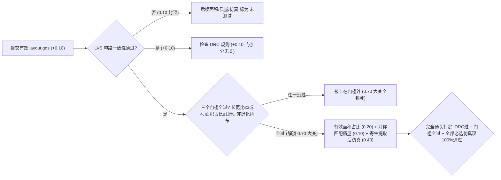
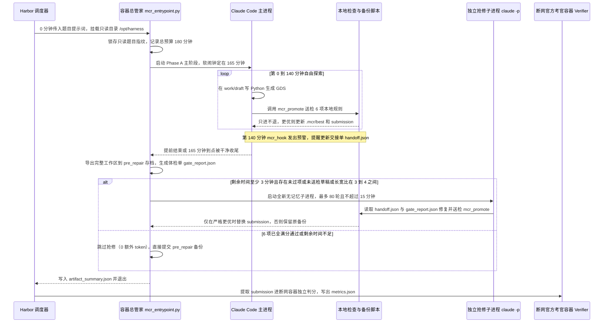
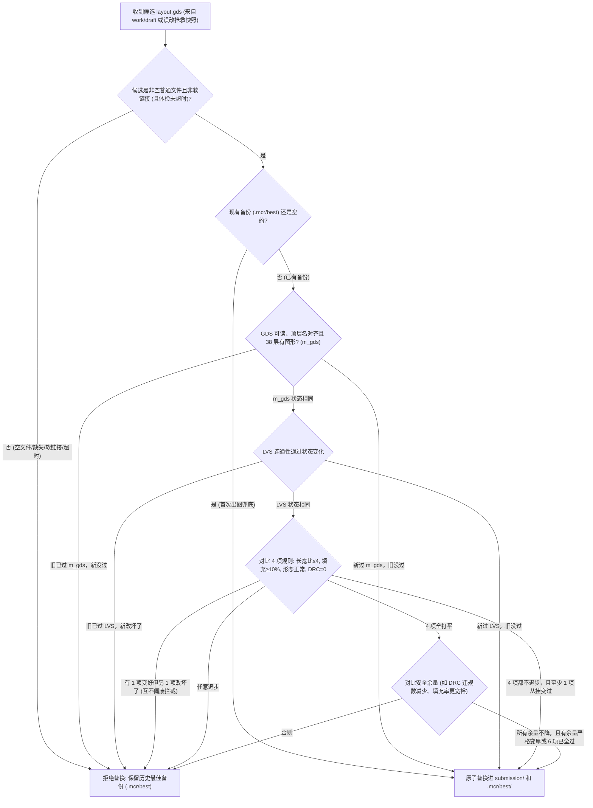
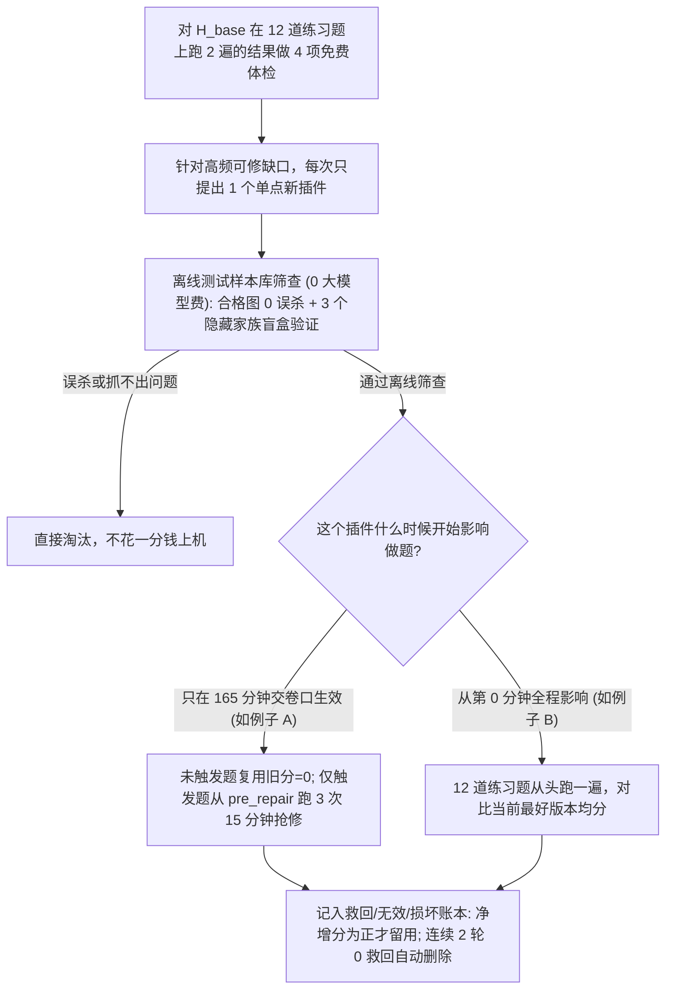
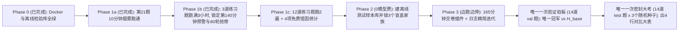

# 实验全流程白话图解指南：大模型是怎么在工作台里学会画芯片版图的？

> **这篇文档写给谁看**：如果你想用最直观的工程大白话，彻底搞懂**芯片版图到底在测什么、3 小时容器里每一分钟发生了什么、我们怎么用极少的花费给大模型“升级工作台”，以及当前已经跑到哪一步**，看这一篇就够了。全文不堆自创黑话，所有专业词都会当场解释清楚，并给出对应的代码文件名和真实命令。

---

## 第 1 节：先认识实验里的所有“角色”和专业术语

在讲流程之前，先把实验里会反复出现的**芯片设计名词**和**软件调度名词**逐一讲透。

### 1.1 芯片版图专业名词（给代码里做的是什么东西）

1. **SPICE 电路网表（题目里的 `task/circuit.spice`）**：
   - **它是什么**：一份纯文本“元件清单与接线图”，写明了这个模拟电路里有哪些晶体管、电阻、电容，每个管子的长宽尺寸是多少，哪几个脚焊在同一根铜线上。
   - **怎么用**：它是题目的死标准，Agent **只能读、不能改**。最后交出去的物理图形，剥开后必须跟这份接线图一模一样。
2. **SKY130 工艺设计套件（PDK）**：
   - **它是什么**：芯片代工厂（SkyWater 130 纳米开源工艺）发给设计人员的“工厂说明书和标准元件积木库”。里面规定了铜线最细能画多窄、两根线隔多远不会短路、不同材料电阻电容怎么算。
   - **两套仿真模型库（`continuous` vs `binned`）**：做电路仿真时要代入晶体管电学数学模型。这套题库里 `31` 道题选用 `continuous` 模型库，`9` 道题选用 `binned`（按尺寸分档）模型库，两者不能混用，容器里通过 `eda_env.sh` 中的 `ALB_MODEL_LIB` 自动选好。
3. **GDSII 版图文件（最终交卷的 `submission/layout.gds`）**：
   - **它是什么**：芯片制造用的二进制几何图纸文件（简称 GDS），里面是一层层密密麻麻的矩形和多边形（有源区、多晶硅栅极、接触孔、第一层到第五层金属线等，共 38 个有效制造图层）。
   - **怎么生成**：Agent 不是用鼠标去画图，而是写 Python 脚本（调用 `gdsfactory` 或 `klayout.db` 库）算出所有元件坐标和走线坐标，自动生成 `layout.gds`。
4. **DRC（设计规则检查，工具：`KLayout`）**：
   - **它查什么**：纯几何体检，就像盖房子的“消防与间距规范”——金属线有没有画得比工艺极限（比如 `0.14 微米`）还窄？两条线隔得太近会不会连锡短路？通孔上下层金属包边够不够宽？
   - **工具说明**：本实验用开源软件 **KLayout** 跑工厂提供的 `sky130A_mr.drc` 规则脚本，输出违规标记报告（`report.lyrdb`）。
5. **LVS（版图与原理图一致性检查，工具：`KLayout` 或 `Magic + Netgen`）**：
   - **它查什么**：电路结构对账。软件把画好的 `layout.gds` 反向识别成晶体管和连线（提取网表），再跟题目给的 `circuit.spice`（部分题目用专门适配了 LVS 语法的 `lvs_reference.spice`）逐一比对：管子数量对不对、尺寸对不对、引脚名字和顺序对不对、有没有多连或断线。
   - **两种工具**：全库 40 题里，38 题用 **KLayout**（`sky130.lvs`）做 LVS；另外 2 道特殊题（第 2 题和第 10 题）用 **Magic** 提取网表后再交给 **Netgen** 比对。
6. **PEX（寄生参数提取，工具：`Magic`）**：
   - **它查什么**：真实物理世界里，金属线哪怕接通了也不是理想零电阻导线，相邻铜线之间还会形成讨厌的寄生电容和走线电阻。**Magic** 会把整个版图扁平化，按层计算真实存在的寄生电阻与寄生电容，吐出一份带寄生元件的真实网表 `extracted.spice`。
7. **后仿真（Post-layout Simulation，工具：`ngspice`）**：
   - **它查什么**：把刚才提出来的 `extracted.spice` 装进测试台（Testbench）里，用开源电路仿真器 **ngspice** 在不同温度、供电电压和工艺角下真实通电仿真，测出放大器增益、相位裕度、带宽、噪声、功耗等电学指标达不达标。
8. **官方计分里的三个“形状与规整度门槛”**：
   - **外框长宽比（Aspect Ratio，`q`）**：包住整个电路所有制造图形的最小矩形，长边除以短边。太细长（比如下限要求 `<= 3.0` 或 `<= 4.0` 的题画成了 `25:1` 的细长条）会直接没收后面的加分！
   - **有效器件面积占比（Area Utilization / Fill Ratio，`rho`）**：电路里真正有用的晶体管、电阻、电容面积总和，除以整个外接大矩形的面积。如果器件稀稀拉拉扔在超大空地上导致占比低于 `10%`（`0.10`），也会卡在门槛外。
   - **退化排布筛查（`meaningless` 检测）**：专门抓那种“把器件排成一长溜、拉几根大总线敷衍走线”的偷懒版图（KLayout 题目会联合检查长总线数、垂直引线数和单排器件占比；Magic+Netgen 的 2 道题豁免此项）。

### 1.2 AI 智能体与调度系统名词

1. **Claude Code（命令行编程 Agent）**：跑在容器里的 AI 程序员，自己决定写什么 Python 脚本、跑什么检查命令、看什么报错日志并修改代码。本实验锁定版本为 `2.1.302`。
2. **Hooks（钩子脚本，`settings.json` + `mcr_hook.py`）**：Claude Code 自带的“事件触发器”。每当 AI 执行完一次 `Bash`、`Write` 或 `Edit` 操作（或者准备结束工作 `Stop` 时），系统会自动悄悄运行一次我们挂载的脚本，用来做备份保护或时间提醒，**AI 感知不到钩子代码本身，也不会打断 AI 的正常试错**。
3. **Harbor（`harbor 0.24.0` 评测调度器）**：统一管理评测的“考务总管”。负责按每题 `6 核 CPU / 32 GiB 内存` 拉起隔离的 Docker 容器、把题目放进去、等最多 3 小时、把交卷目录拷出来，再另起一个**彻底断网**的干净考官容器独立判分。
4. **宿主机计量转发代理（Zero-cache Metering Proxy）**：跑在宿主机 `8791` 端口的小中转站。容器里的 Claude Code 不直接拿真实的 API 密钥，而是拿着一次性临时令牌连宿主机 `8791`；代理在宿主机替它加上真实密钥转给模型网关 `<GATEWAY_URL>`，顺便**只记账不存历史**：统计发了多少请求、用了多少 token、模型网关排队等了多少秒（用于区分“网络/服务器抽风”和“AI 自己没做出来”），**绝不做旧回答缓存重放**。
5. **随机种子（Seed）**：同一道题让大模型独立从零做 3 遍，每次给不同编号（`seed 0, 1, 2`）。因为大模型采样带随机性，同一套方法可能这遍 `0.85` 分、下遍 `0.30` 分，所以最后正式考评必须多跑几遍看平均分和波动幅度。

### 1.3 官方考官的闯关计分逻辑（0 到 1.0 分）



> **为什么区分“没通过”和“前面卡住没测到”这么重要？**
> 从图 1 可以看到：只要 LVS 没过，考官程序就会直接跳过面积占比、质量评分、寄生提取和后仿真，报告里记为 `skipped`（未测试）。如果我们在统计样本时不分青红皂白把“没测到”当成“后仿真没通过”，就会严重误判到底缺哪项检查。
---

## 第 2 节：放大镜看单道题——3 小时容器里每一分钟具体发生了什么？

### 2.1 原装跑法（`H_raw`）vs 带基础保护层跑法（`H_base`）

如果我们直接让原装的 Claude Code 裸跑（代码里记为 **`H_raw`**），它经常会踩两个最冤枉的坑：
1. **死在最后一刻**：明明第 140 分钟已经做出一个能过 LVS/DRC 的版本，结果第 175 分钟想着“再紧凑一点”，把代码改崩了或者文件写到一半，刚好满 180 分钟被 Docker 强杀，直接交了一张残废图或空目录（`0.0` 分）。
2. **漏查硬门槛**：题目说明书里没有明写长宽比上限，AI 画完直接去跑别的，白白丢掉后面的 `0.70` 大分。

因此我们在不改动模型本身的前提下，先人工焊好一层固定不变的基础保护壳（代码里记为 **`H_base`**），在容器 `/alb-workspace` 里划分出四个职责分明的目录：

| 容器内目录 | 谁能写 | 作用与大白话理解 |
|---|---|---|
| `/alb-workspace/work/draft/` | AI 随便改 | **AI 的自由草稿本**。允许 AI 在里面把脚本改烂、试错、重构，**我们绝不在中途强行撤回 AI 的修改**。 |
| `/alb-workspace/.mcr/` | 保护壳管理 | **后台保险箱与工作交接单**。保存 `best/`（目前为止验证通过的最高等级完整备份）、`handoff.json`（交接单）、`gate_report.json`（体检单）和 `trusted_task/`（防篡改的题目原始只读备份）。 |
| `/alb-workspace/submission/` | 保护壳原子替换 | **正式交卷袋**。3 小时结束时，Harbor 只把这一个目录拷走交给考官。任何时候只有确认“新版本严格更好”，才用临时目录写完再瞬间切文件名替换进去，永远不会交出写了一半的损坏文件。 |
| `/opt/harness/` | 只读挂载 | **随容器挂进去的工具箱**。里面放着 `settings.json`（钩子配置）、`mcr_entrypoint.py`（总管家）和本地检查脚本 `mcr_check` / `mcr_promote`。 |

### 2.2 一道题 3 小时（180 分钟）的完整时间线

- **第 0 分钟（开机上锁）**：Harbor 启动容器并调用 `/usr/local/bin/claude`，它透明转发给我们的总管家 `mcr_entrypoint.py`。管家先把收到的题目提示词存成 `.mcr/task_prompt.txt`，把 `task/` 网表和 `eda_env.sh` 复制锁定到 `.mcr/trusted_task/` 并算好 SHA-256 指纹（防止后续任何脚本误改题目原件），然后正式拉起 Claude Code 进入**主做题阶段（Phase A）**，把主阶段的内部硬闹钟定在 **`165 分钟`（`9900 秒`，代码变量 `T_soft`）**。
- **第 0 ~ 140 分钟（自由画图与只进不退备份）**：
  - AI 在 `work/draft/` 里写脚本、跑 KLayout/Magic/ngspice 调试，每当画出一个像样的版图就调用 `mcr_promote` 申请存档；
  - `mcr_promote` 会用本地免费开源工具依次跑 **6 项严格照搬官方规矩的检查**（不靠 AI 猜；若 `.mcr/best/` 还是空的，哪怕初稿还没过 `m_gds`，只要是个非空普通 `layout.gds` 文件也会先兜底存入）：
    1. **文件可读且版图格式正确**（`m_gds`）：`layout.gds` 是非空普通文件（非软链接）、能被 GDS 读取器读出、顶层模块名（区分大小写）对得上、且在 38 个有效制造层上存在正面积图形（另外“`src/` 还没放 `.py` 源码”或“工作区 `task/` 目录被改动过”只作不拦交卷的提醒项——因为题目原件早已锁死隔离在 `.mcr/trusted_task/` 里，绝不会因为漏放源码就把已画好的图拒之门外）；
    2. **电路连通性一致**（`m_lvs`）：跑通 KLayout LVS（第 2、10 题自动从 `eda_env.sh` 识别用 Magic+Netgen）；
    3. **长宽比底线**（`m_shape`）：长宽比 $\le 4.0$（如果落在 `3.0 ~ 4.0` 之间，额外挂一个“经验提醒标签 `advisory_aspect_gt_3`”，提示某些严格题目上限可能是 `3.0`）；
    4. **器件面积占比底线**（`m_fill`）：按提取出来的真实晶体管总面积除以版图外框面积，确认 $\ge 10\%$；
    5. **退化排布筛查**（`m_morph`）：确认不是“把管子排一排、拉几根大长线敷衍了事”的图形；
    6. **物理几何规则**（`m_drc`）：KLayout DRC 报错数 $= 0$。
  - **意外误改兜底**：如果 AI 忘了用草稿区、直接伸手修改了 `submission/layout.gds`，`PostToolUse` 钩子 `mcr_hook.py` 会在工具刚结束的瞬间立刻出手——**先把 AI 新写的内容抢救复制到 `work/draft/_direct_snapshot/`（绝不丢掉 AI 的劳动成果）**，再按同样标准检验它：比旧备份更好就转正，改坏了就瞬间把旧备份恢复回 `submission/`。
- **第 140 分钟（`T_warn = 8400 秒`，比主阶段收工提前 25 分钟、比 180 分钟硬上限提前 40 分钟预警）**：`mcr_hook.py` 在工具调用后悄悄向 AI 注入一条提示：“已经过去 140 分钟，再过 25 分钟主阶段将收尾，请尽快收敛当前修改、运行 `mcr_promote`，并更新 `.mcr/handoff.json` 交接单。”（Phase 1b 实跑时这条线设在第 150 分钟，只留 15 分钟，3 道题里有 1 道到收工都没交出合法版图，所以 Phase 1c 前提前到了第 140 分钟。）交接单限制在 `4 KB` 以内，长得像这样：
  ```json
  {
    "schema_version": 1, "status": "iterating", "top_cell": "ota_5t",
    "known_blockers": ["长宽比当前 3.42 > 3.0，DRC 已清零"],
    "next_steps": ["把偏置镜横向折叠 15% 后重跑 LVS 和 mcr_promote"]
  }
  ```
- **第 165 分钟（`T_soft = 9900 秒`，主阶段收工 + 15 分钟无记忆独立抢修）**：
  - 不管 AI 是提前自己交卷，还是在 165 分钟撞线被 `mcr_entrypoint.py` 干净终止并清理残留子进程，系统都会先把此刻完整的现场打包存进 `/logs/agent/mcr_snapshot/pre_repair/`。
  - 接着 `mcr_check` 扫一眼 `.mcr/best/`：如果还剩至少 `3 分钟`（`180 秒`）时间，且存在下面三种情况之一——**（a）6 项检查还有没全过的；（b）草稿区有新版没来得及送检；（c）长宽比卡在 `3.0 ~ 4.0` 的提醒区间**——系统就启动一个**全新、零对话记忆**的短时抢修子任务（`claude -p --no-session-persistence`，最多 80 轮操作、最长 `15 分钟`），只把工作区文件、交接单 `handoff.json` 和体检单 `gate_report.json` 塞给它修最后一把。
  - **修好就换、修坏不亏**：抢修结束后再次由 `mcr_promote` 检验——只有新版本严格胜出才替换 `submission/`；要是越修越乱，直接丢弃抢修版，稳稳交出 165 分钟之前的老备份！随后保存 `post_repair/` 和 `artifact_summary.json`。
- **第 180 分钟之后**：容器退出，Harbor 把 `/alb-workspace/submission/` 送进全新的**彻底断网**考官容器（最多跑 1 小时），按官方脚本算出真实分数写入 `metrics.json`。

### 2.3 图 2：单道题 3 小时运行与交接抢修时序图



### 2.4 图 3：新画出的版图能不能替换“正式交卷备份”的判断逻辑

（注：`src/*.py` 是否漏写、工作区 `task/` 是否改动过只记作提醒，不拦替换；体检本身超时则保守不动旧备份；若 `.mcr/best/` 还是空的，哪怕初稿还没过 `m_gds`，只要是个非空普通 `layout.gds` 就先兜底存下。）


---

## 第 3 节：我们的方法是怎么“自动改进工作台”的？（带具体插件例子）

在 `H_base` 基础保护层之上，我们让系统围绕 12 道练习题（`dev` 集）自动提议、筛选和评估新插件。注意：**全程绝不碰大模型权重本身，也不看后面的 14 道验证题和 14 道正式测试题**。

### 3.1 第一步：先做 4 项不花大模型费用的错因统计（`ssap alw-diagnose`）

拿 `H_base` 在 12 道练习题上各跑 2 遍（共 24 次运行）后，不花一分钱模型费，直接对保存下来的档案做 4 项体检：
1. **把没满分的题按 4 种死因归类**：
   - **(a) 超时或没交出有效图纸**：比如到点还没保存 `layout.gds`；
   - **(b) 交了图，但在本地能查出来的硬规矩上丢分**：比如长宽比超标、DRC 还有几条违规、LVS 漏贴引脚标签；
   - **(c) 交了图且本地 6 项全过，但在提取寄生参数或后仿真上丢分**：比如走线寄生电阻太大把放大器带宽拖垮了；
   - **(d) 从头到尾 3 小时都没画出过能过 LVS 的半成品**：说明这道题超出了当前大模型自身的能力天花板，直接标出来，**绝不为它硬写偏门规则**。
2. **测一测官方考官稳不稳、本地脚本准不准**：挑几份存档版图用 `alw verify` 连续判两遍看 `ngspice` 自己会不会抖动，同时核对本地 6 项检查和官方考官是不是一致、有没有误判。
3. **测一测同一道题跑两遍的自然波动有多大**：算出 `H_base` 在 `seed 0` 和 `seed 1` 之间的自然分差。这个数字只留着当尺子写进最终报告，**绝不拿它当成“卡死不准采纳新插件”的门槛**。
4. **查一查中途草稿里有没有埋没好版本**：把做题过程中留在 `work/draft/` 里的历史草稿拿去离线打分，如果最高分跟最后备份差不多，就省掉开发复杂“中途选优器”的力气。

### 3.2 第二步：建离线版图检验库，免费把烂插件筛掉（`bank/`）

如果每个新想出来的检查脚本都要上真机器跑 24 次 3 小时才能知道好不好，算力根本烧不起。所以我们先用零大模型费搭建一个**离线测试样本库**（代码在 `src/ssap/bank/`）：
1. **收集历史 + 自动造“假故障”版图**：
   - 把练习集跑出来的合格与不合格版图存进库里；
   - 再用 Python 脚本（`synthesize.py`）对着合格版图精准注入可控缺陷（例如：删掉一个端口标签让 LVS 挂掉、在角落放一小块孤立金属把外框拉长到 `4.2:1`、外围拉一圈大空框把面积占比压到 `8%`、插一根 `< 0.14 微米` 的细线让 DRC 报错），同时也生成只平移网格或旋转 `90°` 的等价合格图；
   - 全部送进离线 `alw verify` 拿到官方考官的真标签。
2. **严格区分“没通过”和“前面卡住没测到”**：如果某张图 LVS 就挂了，官方报告里后面的面积占比、退化筛查、PEX 和后仿真会记为 `skipped`（压根没测到）。入库时我们把这些未测项标为**“未评估”**，绝对不混进“不通过”样本里，避免冤枉后续的检查脚本。
3. **两类插件的权限严格分家**：
   - **严格照搬官方硬规矩的检查脚本**：必须经过离线样本库逐项比对，对所有已知合格版图保持 **`0` 误杀**，必要时根据内外工具小数点微差自动留出一条窄安全缓冲，才准拥有“决定替换正式交卷备份”的权力；
   - **总结经验的提示脚本**（例如提醒长宽比接近 3.0、或提醒差分对对称性）：哪怕离线测试零误杀，**也只准发文字提醒或触发一次受保护的 15 分钟抢修，绝不准覆盖已通过硬规矩的历史备份**。
4. **把 10 个电路家族里的 3 个藏进“盲盒”防死记硬背**：12 道练习题按底层电路结构去重后共 `10` 个独立电路家族（代码里 `G_dev = 10`）。在开始自动提插件前，系统用固定哈希锁住其中 **3 个家族**（`blind_clusters.py`）：负责想新插件的 AI 只能看另外 7 个家族的错题日志，绝对看不到这 3 个盲盒家族的题目和文件；新写出来的脚本必须在这 3 个没见过的盲盒家族上也能抓出真毛病、且对所有合格版图零误杀，才准进入真容器测试。

### 3.3 第三步：两个具体例子看懂“怎么实测新插件到底有没有用”

#### 具体例子 A：在 165 分钟交卷口加一个“寄生提取 + 公开仿真”检查插件

假设做完第一步错因统计，发现有 4 道练习题在 165 分钟时本地 6 项全过了，结果送去官方评分却挂在了 `Magic` 寄生提取和公开 `ngspice` 仿真上。于是我们在第 165 分钟交卷口新加一个插件：在进入抢修判断前，自动补跑一次寄生提取和公开测试台仿真。怎么测它到底提没提分？
- **不触发它的 8 道题（0 元重算，分差精确为 0）**：另外 8 道题里，要么在 165 分钟之前就已经靠旧检查全过了，要么连 LVS 都没过根本轮不到跑寄生仿真。因为我们在第 165 分钟存档点 `pre_repair/` 之前没有改动任何提示词或操作，这 8 道题前 165 分钟的行为一模一样，**直接复用之前的旧分数，花 0 秒、0 token，分差记为 `0`**！
- **真正触发它的 4 道题（从 165 分钟存档点跑 3 遍 15 分钟抢修）**：只把这 4 道题保存好的 `pre_repair/` 完整容器文件夹挂进隔离容器，带上新体检单跑 3 次独立的 15 分钟 `claude -p` 抢修，把抢修前后交卷版图都送去官方评分，一笔一笔记进流水账本（`event_ledger.jsonl`）：
  - 抢修后分数涨了 $\to$ 记为 **“救回（Rescued）”**；
  - 分数没变（包括抢修改坏了，但被我们的防退步保护稳稳挡住、依然交回老备份）$\to$ 记为 **“无效（Neutral）”**；
  - 分数居然比抢修前低了 $\to$ 记为 **“损坏（Damaged）”**（立刻逐条查明原因、补入回归测试库）。
- **省多少开销**：只跑 `4 x 3 = 12` 次 15 分钟抢修（按单次约 `1.5M` 估算，约 `18.0M token`，不到 1.5 小时），相比把 12 题从头重跑 3 遍 3 小时（按单题平均 `13.2M token` 估算，约 `475.2M token`，十几小时），省下了 **约 96.2% 的模型费用**，而且把那 8 道没触发的题自身的随机波动彻底剥离掉了！

#### 具体例子 B：加一个“KLayout/ngspice 万行报错日志翻译器”插件

假如我们观察到 AI 经常在读 3 万行 KLayout LVS 报错日志时看晕，漏掉真正断线的网名，于是写了一个 Python 过滤脚本，把万行日志浓缩成十几行“哪个模块、哪个引脚没连上、哪条金属宽度不够”的精准摘要。
- **为什么这种插件不能只测最后 15 分钟？** 因为它从第 1 分钟做题开始就改变了 AI 在终端看到的输出内容，后续每一步写代码、改坐标的轨迹都会跟着变。
- **怎么测？** 只能老老实实把这 12 道练习题从第 0 分钟重新跑一遍，跟当前最好的版本在 12 题上的平均分做配对对比（如果只挂载在特定工具钩子上，还会顺带查一下“两边都没触发这个钩子的那些题”平均分有没有跟着漂移，确保没有悄悄改坏全局提示）。

**简单的留用与大扫除规矩**：每一轮只准改动**这 1 个地方**（不搞多个改动打包乱炖，否则不知道是谁起的效）；交卷口插件只要在流水账本上**净救回总分为正**就留用，全程插件只要 12 题平均分严格高于当前最好版本就留用；如果某个留用的交卷口插件连续 **2 轮** 救回次数都是 `0`，系统自动把它清理删除，防止工作台越改越臃肿。

### 3.4 图 4：工作台新插件从“错因分析”到“离线筛查”再到“实测留用”的完整流程


---

## 第 4 节：整场实验的五步路线图、服务器命令对照与最终实验大表

### 4.1 40 道题的三组隔离与当前进度全图

为了防止优化插件时“对着考题背答案”，全库 `40` 道题在动跑第一道题之前，就按底层电路结构去重、严格拆成互不重叠的三份（每一份都保留 `3` 道 `binned` 库题目，不把相似电路拆到两边）：
- **练习集 `dev`（12 题，10 个独立电路家族）**：全程可见（其中 3 个家族在写插件时藏进盲盒），用来分析错因、离线检验和迭代升级；
- **验证集 `val`（14 题，14 个独立电路家族，按宽松归并算 12 个家族）**：平时全程封存，只在准备定稿时做**唯一一次**二选一拍板；
- **测试集 `test`（14 题，11 个独立电路家族，按宽松归并算 10 个家族）**：终极大考，代码指纹锁死后才拆封考唯一一次。



### 4.2 分阶段命令对照表（对应 `ssap` 真实入口）

> 当前共享宿主机可用内存 `259 GiB` 且 **`Swap: 0B`**，所有带模型的命令统一默认 `--parallel 4`（上限 `6`，严禁 `8`），并提前加载 `ALW_REPO`、`$SSAP_STATE`（在 `/localdata/<USER>/...`）及 `HARBOR_TELEMETRY=0 LITELLM_LOCAL_MODEL_COST_MAP=True`。

| 阶段 | 状态 | 在服务器上跑什么命令（关键参数） | 要看什么验收信号 |
|---|---|---|---|
| **Phase 0** | **已完成** | `ssap alw-check-split`、`pytest`、`ssap alw-concordance --offline-smoke-container --docker yes` | 切分全过、`150 passed, 1 skipped`、本地和真容器双 `"ok": true`（0 模型费） |
| **Phase 1a** | **已完成** | `ssap alw-eval --mode smoke-10m --arm H_base --timeout-s 600 --t-warn 300 --t-soft 390 --harbor-cmd ...` | 题 `#21` 跑通 51 次模型调用、触发 15 分钟抢修通道、断网评分正常落盘 |
| **Phase 1b** | **已完成** | `ssap alw-eval --mode subset --arm H_base --parallel 3 --tasks <小/中/大3题ID> --harbor-cmd ...`（当时配置：第 150 分钟预警、15 轮抢修） | 3 题容器墙钟约 2.7–2.8 小时（满 3 小时预算内正常收尾）、峰值内存都不到 `0.6 GB`、未出现 OOM `137`；同时暴露 3 个问题（计量代理把客户端正常断开误记成网关故障、预警太晚、15 轮抢修太短），Phase 1c 前已修复，详见 [alw-deployment-log.md](alw-deployment-log.md) §4 |
| **Phase 1c** | 待运行 | 分别跑 `ssap alw-eval --mode baseline --split dev --arm H_raw` 与 `H_base`（`--seeds 2 --parallel 4 --harbor-cmd ...`），后接 `ssap alw-diagnose --split dev` | 收齐练习基线运行并产出 4 项零模型费错因体检报告，决定开哪些改进插件 |
| **Phase 2** | 待运行 | `ssap alw-concordance --build-bank --mutate --freeze-blind --calibrate-eps` | 0 模型费生成变异缺陷图并重判分，锁死 3 个盲盒家族和窄安全缓冲（`0` 误杀） |
| **Phase 3** | 待运行 | `ssap alw-loop --rounds 1 --parallel 4` | 用 165 分钟存档重放和（如有）日志精简跑完第 1 轮迭代，生成流水账本 |
| **验证与大考** | 待运行 | 在 `val` 上跑完 `baseline` 后执行 `ssap alw-eval --mode c1-val --inc-scores <新> --base-scores <旧> --inc-version <版本>`；`test` 跑 3 遍后执行 `ssap alw-report --split test --seeds 3 --selected-version <定稿版本> --with-baselines` | `val` 上平均分严格更高（净增超过 `0.000001`；打平保留更简单的 `H_base`）就采用新版，否则用回 `H_base`；随后 `test` 跑 3 遍出最终表 |

### 4.3 最终交付要看的 4 行对比大表（14 道密封测试题 $\times$ 3 个随机种子）

为了彻底不自欺欺人，代码锁死后我们在 14 道从未见过的密封 `test` 题上，每个版本独立跑 **3 个随机种子**（`14 x 3 = 42` 次/行），把四行干净地摊在同一张表上比较：

| 对照版本 | 它代表什么 | 为什么要放在最终大表里 |
|---|---|---|
| **1. `H_raw`（原装默认版）** | 裸跑原生 Claude Code，没有任何本地检查、防退步备份或收尾抢修 | 衡量“什么都不加”时大模型的原始裸考水平 |
| **2. `H_base`（人写基础保护版）** | 加上 6 项本地规则校验、草稿/交卷分离和 165 分钟独立抢修的基础壳 | 测出“纯工程保底”救回了多少分（`H_raw -> H_base` 这段功劳不算在自动优化头上） |
| **3. `H*`（自动升级最终版）** | 在练习集选出、且在 `val` 验证集平均分真实胜出的最终工作台版本 | **只有 `H_base -> H*` 这一截涨分，才是自动进化工作台真正赚出来的本事** |
| **4. 人工一页注意事项对照版** | 把画版图常见注意事项（长宽比、早存盘、查 LVS 等）人工写成一页静态说明 | 验证“一套自动体检 + 抢修工作台”是不是比“人工花半小时写一页提示词”更有效 |

在这张表旁边，最终报告还会老老实实并列交代 **4 件事**：
1. **3 个随机种子之间的自然波动幅度**：看清楚涨分是不是明显压过模型自身的随机抖动；
2. **实质通关 vs 局部加分拆账**：涨分里有多少是“原本不及格、现在彻底通关（`design_passed=true`）”挣来的，多少是“虽然没全过、但面积或局部规则变好了”挣来的；
3. **硬件故障单独记账**：机器内存爆掉（`137`）或模型网关抽风超时单独记录并公平配对重跑，AI 自己没画出来或超时交白卷严格算 `0.0` 分，绝不删题美化平均分；
4. **真金白银花销账本**：把总消耗的输入/输出/缓存 token、折算美元、工具占用的 CPU 秒数、内存峰值和总耗时（包含搜索和验证过程），连同“拿同样多的钱直接让 `H_base` 多抽几次挑最好结果”的对照线一起写清楚。
