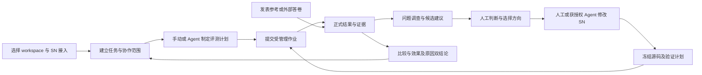

# Silicon Notebook 评测与改进工作台 PRD

版本：v0.4  
日期：2026-10-11（v0.4 修订）  
状态：持续演进的产品需求草案；界面与技术细节在开发中收敛，未实现能力另行标识。

本文依据截至 2026-10-11 的产品讨论、交互重设计和 Paseo 本地源码研究，描述 AI 协作式评测与改进工作台。workspace／Agent 协作与单服务器方向已明确；界面和技术尽量向 Paseo 对齐。独立工作台＋Paseo 公共 SDK 是当前推荐，不冻结承载形式、组件数量、worktree 默认策略或依赖版本。具体 provider 能力与源码捕获在开发时确认。本文新增规划不改变 [CURRENT_STATE.md](../CURRENT_STATE.md) 中的执行范围，不授权实验、模型调用、安装部署或生产变更。服务器当前成绩与进度未在本轮重新核实。

## 文档使用方式

本文是开发起点。FR／AC 描述希望支持的行为和检查场景，具体页面、交互形式、模块分期及技术手段可以在开发中调整。优先做出可运行的完整路径，再根据真实材料和用户反馈收敛；无需在此阶段逐项敲定或新增一套审批流程。涉及已有评分协议、来源与历史真实性的要求仍按当前实现和证据处理。

## 1. 产品目标

让研究者和 SN 开发者从可信的评测结果出发，判断系统表现、调查具体失败、获得可实施的改进建议，再用新的实验验证建议是否有效。论文比较与日常研发共用可追溯的证据。

产品应持续回答五个问题：

1. 当前版本在公开 benchmark 和已核验案例上表现如何？
2. 相比已有方法或旧版本，改善和退化在哪里？
3. 哪些问题值得优先调查，已有证据能支持什么判断？
4. 具体可以改什么，怎样以较低成本验证这个方向？
5. 改动是否解决了问题，是否带来新的退化或额外成本？

首版核心交付是**以 workspace 和任务组织的 AI 协作工作台**。用户可以手动选题、评测、查看证据、保存判断，也可以让可用 Agent 帮助制定计划、执行已明确范围的评测、调查失败、修改 SN 并验证变化。左侧组织 workspace 与任务，中间承载目标、Agent 对话、进度和决定，右侧按需打开文件、改动、成绩和证据。详细信息在需要时展开，使用户先看到当前工作、发现和待决事项。工作台生成可追溯的改进建议报告。报告允许输出“证据不足，先补充观测”或“本次未形成可支持的改进建议”。建议数量和措辞流畅度不作为产品价值指标。

## 2. 背景与当前基础

现有项目已投入较多工作对齐数据、官方评分、题单、分母、证据映射与可靠保存。这些能力使结果可以复查；下一步需要让结果直接服务于研发决策。

| 能力 | 当前事实 | 本 PRD 要补齐的行为 |
| --- | --- | --- |
| 五套 benchmark 与官方评分 | 已有适配、答卷导出、评分和外部答卷导入实现 | 在报告中呈现正式结果、来源和适用范围 |
| 方法与版本比较 | 已有身份检查、逐题差分、批量指标和适用时的分组统计 | 比较结果直达案例、问题和建议；复用现有计算 |
| 案例回放 | 已有离线实验地图、单题流程、已采集原生 span 与结果分析 | 连接正式比较与独立补评批次，展示诊断所需证据 |
| 人工复核 | 已有分层抽样和初始空白标注文件 | 界面保存、修订、查询与建议关联；保留文件导入／导出 |
| 改进建议 | 尚无本 PRD 所述的完整自动分析流程 | 规则提取事实，模型提出假设、动作和验证方案 |
| 修复与回归 | 已有固定题单运行入口与结果比较 | 连接案例、建议、基线、修改版本及验证结论 |
| 运行管理 | 现有 CLI 与执行者组织 campaign；没有统一 Web 作业入口 | 新工作台提供评测计划、题目选择、任务状态、取消和历史；CLI 保留为维护与故障排查入口 |

依据：[当前架构](../ARCHITECTURE_CURRENT.md)、[实验 Dashboard](experiment-dashboard.md)、[正式比较实现](../src/rag_eval/benchmark_comparison.py)、[案例复核实现](../src/rag_eval/benchmark_review.py)。代码已有不代表服务器全量验收完成。

## 3. 用户与主要任务

| 用户 | 主要任务 | 交付给用户的结果 |
| --- | --- | --- |
| SN 算法／产品开发者 | 找到值得修的问题，选择修改方向，验证效果 | 带证据的建议卡、调查项、修复前后比较 |
| 研究者／论文作者 | 了解公开评测表现，选择可报告的比较与案例 | 正式结果表、发表参考、条件说明、可追溯案例 |
| 人工评审者 | 判断失败是否成立，核验参考与原因假设 | 独立的人评记录、理由、证据和未决事项 |
| 实验执行者 | 确认输入与范围，区分补评和重新生成 | 具体的验证实验说明、结果完整性与缺口清单 |

首版按单服务器、小团队的使用场景设计，可围绕 SN 的不同 checkout／worktree 建立 workspace。提供基本访问控制和操作者记录；复杂多人审核和分布式调度后置。已有可点击原型作为讨论起点；视觉与交互细节在可运行工作面上继续借鉴 Paseo 并调整。

## 4. 范围与阶段

### 4.1 当前目标行为

- 导入并校验已保存结果，呈现完整范围、正式分数、状态与证据可用性。
- 支持一份 SN 结果的失败分析，不要求先有外部方法或第二个 SN 版本。
- 有两份可配对结果时，复用现有比较器呈现逐题变化；有论文汇总值时，登记为发表参考。
- 自动形成问题清单、候选原因及改进／调查建议，每条建议可打开来源案例。
- 在界面保存人工复核记录，并支持导入／导出，保留修订历史；人工判断与官方分数分开。
- 人工选择建议后，形成验证实验说明；从界面或命令行提交验证任务，也可关联已有结果，查看修复前后结论。
- 提供 Web 工作台，支持选择 benchmark、任务、题目和运行配置，启动评测，查看状态和历史。
- 导出可独立阅读的报告和机器可读记录，保证以后仍能修改和继续分析。
- workspace 绑定 SN 目录／worktree 和运行配置；其中的任务可关联多次评测、分析、修改与验证。
- 接入可用 Agent，会话可继续、替换或交接；Agent 经共同应用接口操作评测能力，用户保留手动入口。
- 在明确目录、变动范围、预算和停止条件后，由当前或另一 Agent 修改 SN；保留改动与实际被测版本的关联。
- 按需展示文件、diff、结果和证据；benchmark 目录与协议详情放入设置／资源，但选题在任务内直接可达。

Web 工作台是正式产品入口。命令行继续支持评测、分析、查询和维护，两个入口共用相同的业务能力和校验规则。现有 Dashboard 不再作为新功能的承载层；它只在迁移期间用于读取旧报告，后续可以废弃。

### 4.2 后续能力

- 人工核验后的业务案例库及持续回归集合，连接真实用户反馈。
- 开源工作台中的多人复核、版本趋势、问题与修复检索。
- 多人权限、任务抢占、复杂审核流和跨项目协作。
- 利用经过验证／否定的历史建议，为后续分析提供可追溯的参考。

首版允许登记可重放的真实案例和人工参考，不能据此宣称已经覆盖完整业务案例生命周期。业务回归案例不改变五套公开 benchmark 的支持集合。

### 4.3 非目标

- 无明确范围的自动改码、从资料自由文本直接执行命令，或把建议采纳等同于提交、合并、部署授权。Agent 的有界 SN 修改进入规划；发布操作不属于默认闭环。
- 重写五套官方 scorer、重复建设已有差分计算，或同时部署多个重叠工作台。
- 新增公开 benchmark、默认扩展 reasoning／消融／外部方法实验范围。
- 用跨 benchmark 总分排序系统，或根据默认阈值自动发布。
- 把低组件分、一次模型解释或一次前后分差自动当作根因证明。
- 把现有 Dashboard 扩展成新的产品入口；新工作台使用新的领域与界面契约，前端承载可选 Paseo 插件或独立应用。

## 5. 完整用户流程

任务记录目标和关系，不以某次 Agent 会话结束作为完成证据；Agent 对话引用正式工件，不能代替正式成绩和执行记录。

### 5.1 从选题到评测结果

1. 用户打开工作台，选择或登记 SN workspace，核对目录／worktree 与被测服务的关系。
2. 用户建立任务，手动选择 benchmark 任务、题目范围、模型配置和评测模式；也可让 Agent 提议计划，再在同一选题控件中检查或调整。
3. 系统显示实际选择题数、输入版本和资源估算；无法估算的成本明确标为未知。
4. 用户确认计划并启动评测。
5. 系统创建不可变评测计划和新的评测作业（Job），挂到当前任务；冻结实际源码与运行绑定，无法确认时保留未知及限制。
6. 用户查看任务状态、已完成题数、错误题数和可用结果。
7. 用户打开结果页，查看正式分数、覆盖范围和问题清单。
8. 用户打开案例，查看答案、证据、评分和建议。
9. 用户保存人工判断或启动验证计划。
10. 用户在历史页查看旧任务、旧报告、建议和验证记录。

前端或 Agent 工具提交的是结构化评测计划。以下用户确认步骤描述手动流程；已明确委托且范围匹配时，由 Agent 执行同一提交动作，保留范围、授权及操作回执。后端固定实际 case IDs，保存题单 hash，再按既有 partition × mode × attempt 拆为独立 run。选少量问题不裁掉对应分区的完整资料。用户关闭或刷新浏览器不取消任务；再次打开后可以查询服务器状态。取消时停止后续派发，并向当前执行进程发送取消请求；只有执行端确认后才显示已取消。

### 5.2 一份 SN 结果到改进建议

1. 用户选择结果包、评分批次和分析范围；可选已有复核记录与对应版本源码。
2. 系统校验身份，显示计划题数、实际输出、评分完成度和证据缺口。
3. 系统从已有分数、状态和观测中形成问题候选，区分产品问题、运行问题、评测问题及待调查项。
4. 用户确认本次分析范围与模型分析预算后，由评测服务器上的分析进程生成报告；确定性结果浏览不需要调用模型。
5. 用户打开建议卡，检查支持与反对证据，完成人工复核，选择后续调查或验证方向。

没有可靠参考或自动分数的题仍可进入人工审查；系统不能因此直接判定回答错误。没有外部对照也可以完成上述流程。

### 5.3 公开方法比较到论文材料

1. 用户选择 SN 正式结果，并登记论文／作者汇总值或导入外部答卷。
2. 主表展示各方法声明范围内的正式成绩、覆盖、条件和来源。发表参考无需逐题答卷或重跑。
3. 对符合现有配对条件的结果，另外展示逐题差异和共同有效题范围；不能用成功交集替代主结果。
4. 用户打开差异案例并复核，再导出结果表、比较限制和案例说明。

沿用[实验结果表与填报协议](benchmark-result-tables.md)。ALCE 三任务分别报告，ASQA 全量 948 题与公开 100 题样本分开；缺少完整所见文档映射时明确说明引用指标不可用。作者汇总值只能支持其记录条件下的参考比较，不能由该值反推出逐题错误或内部原因。

### 5.4 一个失败到修复验证

示例场景：用户发现会议总结遗漏了最终决定。

1. 登记问题、资料版本和真实回答；人工确认遗漏是否成立。
2. 查看决定对应内容是否被导入、检索到、选入合成上下文，以及回答是否使用了它。
3. 提出原因假设及替代解释，选择最小改动；证据缺失时先安排观测核查。
4. 用户可以自行修改，或明确交给当前／另一 Agent 修改。记录目录、允许改变的范围、执行预算、停止条件及已有未提交改动；可复用当前 worktree 或另建，默认方式结合开发反馈确定；记录已有 dirty 内容和实际修改。本轮不创建 worktree。
5. 修改后检查 diff，记录基线与改后源码快照，核对运行中的 SN 实际加载版本。在运行前记录验证范围、主要指标、人工检查项和可接受代价。
6. 用户或已获该范围授权的 Agent 通过共同接口提交验证作业；也可关联已完成结果。新结果复用现有比较能力。
7. 人工记录“改善／未改善／存在取舍／证据不足”，并单独判断结果是否支持原因假设。

用于发现问题、调参的案例必须标明用途。验证还应包含未参与该次修改选择的样本；已反复用于诊断的测试题不能继续宣称为未触碰的保留评测。无法提供独立验证时，结论限定为所选案例上的观察。

### 5.5 Agent 协作与自主程度

保留三种使用方式作为待评审设计：**辅助**（Agent 读材料、提议计划，人提交执行）、**协作**（Agent 执行已指定动作，人处理关键取舍）、**委托**（Agent 在已明确目标、目录、工具、预算和停止条件内连续推进）。不要求每个已授权步骤再次确认；超出范围、无法确认被测版本、预算耗尽或写入冲突时停下并说明原因。

保存建议或人评不触发执行。用户可在同一次明确委托中允许“评测→调查→修改→验证”；每次实际执行仍建立独立计划／作业和工件。换 Agent 交接目标、已做事项、正式工件引用、权限范围与未知项，不能仅交接聊天摘要。可用 Agent 的创建／恢复／导入取决于 provider 能力，不承诺任意历史对话可直接恢复。

## 6. 功能需求

### FR-01：结果接入与完整性检查

- 接入现有 run、submission、scores、comparison、review 及独立补评产物；适配器复用已有校验入口和身份。
- 显式选择本次分析所用答卷与评分批次。重复导入相同内容不增加题数；同 ID 内容冲突阻止合并并提示来源。
- 按指标显示实际分母、eligible 范围和缺失原因；零分、error、pending、missing、N/A 保留各自含义。
- 生成状态与评分状态分开。正式 scorer 按协议对空答案给出的零分仍是有效分数，原生成状态同时保留。
- 主结果使用原正式汇总；批量指标不能被平台逐题均值替代，也不能拆造逐题分数。
- 缺少 review 级证据时仍可读成绩，但需要这些证据的诊断显示不可用及所需材料。

### FR-02：成绩与问题总览

- 按 benchmark、任务、方法、版本、范围、指标和状态浏览；不生成跨套件总分。
- 单结果视图展示成绩与待调查问题；比较视图额外展示条件差异、适用的逐题变化。
- 问题初始类别包括输入／导入、检索、证据选择、答案合成、引用、运行可靠性、评测异常、未知；允许一题多个候选类别。
- 自动指标异常、模型判断、人评确认分别标记。分数相同不等于答案质量相同，分数下降不自动等于语义退化。
- 没有源码、轨迹或完整上下文时就地说明，不把“没有记录到”写为“没有发生”。
- 规则扫描可独立于模型分析执行。问题视图注明扫描版本、覆盖与来源；尚未扫描不等于没有问题，规则命中不等于人工确认错误。

### FR-03：案例回放与证据包

- 支持从问题／建议打开题目、原回答、评分使用的回答、参考资料、引用和已保存的真实观测。
- 两份结果并排阅读时保留各自配置与实际输入；多个组件调用不能按名称强行一一对应。
- 每个证据片段能回到原文件或已验证快照；摘要与截断片段标明范围，并可取得原始上下文。
- 若需定位代码，优先读取实际实验源码快照或对应提交；版本无法确认时仅给模块级调查方向，不编造文件行号。
- 原生组件分与完整轨迹指标分别展示，不为历史答卷生成虚构 Agent 调用树。

### FR-04：问题诊断与分组

诊断按以下顺序组织：

1. **提取事实**：确定性核对身份、状态、分差、材料可用性和可核验映射。
2. **选择案例**：记录选择规则、种子、总体范围与已分析数量；已有配对复核沿用 task × metric × 分差方向的 seeded 抽样。另行排序的调查清单必须单独标识。
3. **逐案分析**：模型或人工提出候选原因、支持证据、反证和缺失观测。
4. **归纳模式**：按共同现象与证据合并案例，同时保留反例和不符合模式的案例。

分层复核样本不能直接估计总体错误率。建议中的“涉及多少题”必须注明是规则全量扫描、模型检查范围，还是人工核验样本。公开 gold 通常不是所有有效证据的穷举；未命中标注证据不自动证明检索内容无用。

| 可核验现象 | 候选调查方向 | 还需要确认什么 |
| --- | --- | --- |
| 所需资料在源快照存在，但导入记录显示缺失 | 解析／导入 | 导入是否完整，是否仅观测缺失 |
| 已导入资料包含必要信息，保存的检索结果未覆盖 | 检索 | 是否保存了完整相关阶段结果，是否存在其他有效证据 |
| 检索结果含必要信息，最终上下文未包含 | 重排／去重／截断 | 阶段映射、预算、选择依据是否充分 |
| 必要信息确实进入上下文，回答仍遗漏或矛盾 | 合成／任务指令 | 问题是否歧义、参考是否合理、模型输出如何使用证据 |
| 答案与引用来源不一致 | 引用选择／映射 | 是语义支持问题还是记录／投影错误 |
| 答案可用但指标评分失败 | 评测链路 | scorer、依赖或输入格式的实际错误 |

以上只定义调查线索，不将候选方向直接登记为已确认根因。

### FR-05：改进建议生成

建议生成器使用核验后的事实摘要、案例证据、人工记录和可选对应源码。采用“规则负责可确定事实，模型负责假设与方案组织”的分工；不允许模型改写正式分数或来源身份。

每条建议至少包含：

| 字段 | 产品要求 |
| --- | --- |
| 标题与问题 | 描述具体触发条件、现象和待改善行为 |
| 类型 | 产品改进、工程可靠性、评测修复或补充观测 |
| 适用范围 | 来源批次、任务、分析题数、支持案例与反例；不越出已观察范围 |
| 证据 | 可打开的案例与片段引用，区分机器事实、人评与模型判断 |
| 原因假设 | 解释证据与现象的联系，列出替代解释和未知项 |
| 建议动作 | 具体调查／修改环节；有源码依据时给对应位置及版本 |
| 最小验证 | 比较对象、控制条件、变动因素、题目范围与需要补充的观测 |
| 验收与否定条件 | 什么结果支持、反对或不足以判断该建议；主要指标及退化检查项 |
| 代价与风险 | 已测量成本、待测代价、可能受影响的任务；未知值不填零 |
| 优先级依据 | 严重程度、已知影响范围、证据充分程度及验证工作量；人工可调整并记录理由 |
| 来源与状态 | 分析版本、模型／提示身份、关联人工记录、后续验证记录 |

证据充分程度用可解释标签描述，不输出未经校准的概率。每个事实引用必须能解析到输入证据；校验失败的建议不得进入正式报告，应保留诊断信息。语义上是否支持该主张仍需人工检查。

建议不足时允许零条输出，并列出阻碍分析的缺口。不得为了凑数量生成“优化 prompt”“换更强模型”等缺少问题依据和验证方法的泛化建议。

### FR-06：人工复核与决定

- 人工可确认／否定／暂缓问题，填写理由、证据、候选原因和下一步。
- 支持模型判断与人评有分歧，官方分数保持原样；参考或 scorer 确需修正时走新的版本及重评流程。
- 人工记录保留评审者、标准版本、时间、原案例身份和修订关系；修订不能静默删除旧判断。
- 用户可以在工作台直接提交人工判断。后端持久化成功后返回修订编号，页面才显示已保存。文件导入／导出作为命令行及离线交换能力保留。
- 界面提交或文件导回时验证对应案例和评分批次；来源冲突进入待处理状态，不自动覆盖。多人修改保留各自记录，不能默认为后一位覆盖前一位。
- 如安排独立双人复核，应分别分配任务；共享队列中“任意一人完成即结束”不等价于双人完成。

### FR-07：验证实验说明与回归关联

- 用户选择建议后，系统生成可审阅的实验说明；用户可通过工作台或命令行提交验证任务。生成建议或保存说明本身不启动模型、不修改代码，也不扩大实验范围。
- 说明绑定基线、数据／题单、scorer、拟变动因素、修复版本、主指标、人工标准和成本观测。阈值与接受条件应在新实验前记录，不能见分后倒推。
- 关联工作台任务或外部执行者返回的新工件，复用正式比较器；不另建重复差分器。
- 同时查看目标案例和额外验证样本；仅测试修复样例时明确限制结论。
- “效果改善”和“原因假设得到支持”分别填写，允许效果改善但原因未明。
- 首版可导入并关联少量验证结果；整体改善率、统计显著性和独立验证强度依赖实际实验设计，不默认承诺。

### FR-08：交付、检索与复用

- 输出可阅读报告及机器可读的建议、人评、验证关联记录；格式细节留给后续设计。
- 报告包含原成绩、覆盖、问题清单、建议、证据链接、分析范围及未决项。
- 论文表格沿用已有结果表协议；新分析报告不能更改旧结果表的数值或口径。
- 报告记录输入版本和生成时间；新评分或人评不会让旧报告静默变化，需形成新报告版本。
- 历史建议按适用版本与条件检索。相似文本不意味着相同原因，已否定方案再次提出时须解释条件变化。

### FR-09：评测工作台前端与任务管理

- 用户可以选择 benchmark、任务、题目范围、评测模式、模型配置和评分配置。
- 系统按服务端配置的可用模式与当前执行策略提供选项；退役 benchmark 不进入目录，尚未就绪的配置说明原因。当前 SN-only 范围属于执行策略，不硬编码成前端的永久能力限制。
- 用户确认后，服务器创建不可变 `EvaluationPlan`，保存输入版本、题目清单、配置身份和预算。
- 任务管理器为每次执行创建独立 run 和 attempt；不在旧 run 目录中续跑。
- 页面显示计划、排队、运行、部分完成、完成、错误、取消和中断状态。
- 页面显示已计划、已生成、已评分、错误、缺失和未开始数量。
- 用户可以请求取消任务；系统显示取消请求、执行端确认和已保存结果。
- 用户可以从任务页进入成绩、案例、建议、人工复核和验证记录。
- 页面显示任务的输入、代码、模型、scorer 和题目清单身份。
- 全量、筛选、逐题选择和固定种子抽样均在提交时解析为固定题单；保存原选择规则，历史重开不能受筛选条件变化影响。
- 重复点击或请求重传不重复启动任务；只有显式再次运行才创建新 attempt。
- 用户分别选择生成、评分／补评、分析等操作；评分失败可以复用已存答案补评，不默认重新调用 SN。
- 重试新建 attempt。历史任务没有登记到任务管理器时，只读展示，不假定平台拥有其进程控制权。

### FR-10：历史、草稿与记录

- 系统保存评测计划、运行任务、评分批次、分析批次、建议版本、人评修订和验证记录的索引。
- 用户可以按 benchmark、任务、版本、状态、时间和标签查询历史。
- 历史记录链接到不可变结果工件；删除或重建页面不会改变结果。
- 新评分、新分析和新人评形成新版本，不静默覆盖旧历史。
- 用户可以复制旧计划创建新计划；复制动作必须显示继承的输入和需要重新确认的字段。
- 用户可以打开历史报告，即使当前没有模型服务或运行进程。
- 界面和命令行创建的记录都可登记到同一历史；既有 CLI 结果通过显式导入接入，并标明是否由工作台管理。
- 刷新页面、退出后重新访问或重启服务不丢失已提交计划、人评、标签和历史。临时浏览器缓存不能承担保存责任。
- 历史支持跨类型查询及关系跳转；时间线和按类型分组均使用相同来源。实验时间未知时显示未知，不用导入时间替代。
- 用户点击“保存草稿”后，只有收到服务端持久化回执才显示已保存。普通保存和导航不额外要求确认；提交评测或模型分析在展示范围与预算后通过明确动作执行。

### FR-11：workspace 与任务组织

- workspace 使用稳定身份，登记 SN 目录、仓库／worktree、分支与运行配置；路径或分支是可变位置，不是评测版本。
- 任务保存持续目标、计划和关联结果，可跨多次运行、改动及 Agent 会话。一个 workspace 可有多个任务；一项任务可有多个协作者。
- 已保存计划明确区分工作任务 ID 与 benchmark 的任务类型；FR-09 中“运行任务”指 Job，不与持续 Task 共用状态。
- 运行记录实际源码快照及被测运行实例身份；工作目录未提交变更与运行中加载代码不一致时提示，不能只以分支名证明同版本。

### FR-12：Agent 接入与工具操作

- 展示可用 provider、会话及能力，支持其实际提供的创建、恢复、导入和交接。
- Agent 使用与 Web／CLI 相同的结构化评测命令和校验；工具结果返回 job ID、状态及工件引用。
- Agent 会话结束、暂停或关闭面板不自动取消受管理 Job；取消 Agent 与取消 Job 分别表达。
- 会话消息中的分数和完成声明必须可打开正式来源；缺来源的叙述不登记为完成结果。

### FR-13：修改 SN 与验证变化

- 用户明确变动范围后可交由 Agent 修改 SN，记录发起者、执行者、基线、已有 dirty 状态、实际 diff 与改后快照。
- 同 checkout 的多个写入者必须协调；冲突时不继续写，也不清理用户原有更改。具体协调机制留到实现设计。
- 评测绑定稳定源码及实际 SN 运行配置；改文件不等于运行服务已加载改动。未核对时不作确定版本归因。
- 验证记录关联建议／人评、改动及比较结果。提交、合并、部署分别需要明确操作范围，不由验证通过自动触发。

### FR-14：任务工作面、专用组件与资源设置

- 左侧按 workspace 组织任务及关联 Agent；中间显示对话、目标、进度、结果摘要和待处理决定。
- 右侧按需打开文件、diff、成绩、案例证据与比较；单结果可直接阅读，不要求先聊天或生成建议。
- 默认只展示当前任务所需信息，完整成绩、分母、来源与不可比原因仍可直接展开；不能以 AI 摘要隐藏失败或退化。
- 任务工作面帮助用户确认目标、实际版本和活动状态；计划、进度、调查与验证可用卡片、工具结果或行内内容呈现，数量与位置在开发中调整。执行和完成信息来自真实对象及回执，不能由 Agent 自由文本直接证明。
- 进度卡原位更新，历史记录固定旧版本；材料面板不被后台结果自动替换。输入框可以引用题单、结果、案例和改动的有界上下文附件。
- 组件的读取、操作与边界见[交互参考](product/sn-workbench/interaction.md)，事件恢复及修订见[接口草案](product/sn-workbench/api-and-events.md)。
- 设置／资源提供五套 benchmark 的任务、范围、协议、来源和可用状态，以及 Agent／SN／模型配置；任务内保留选题与范围检查入口。
- 历史、发表参考、手动执行和报告导出可从 workspace／任务访问，不依赖 Agent 在线。

## 7. 信息归属与生命周期

以下是产品概念，不在 PRD 中提前冻结新的存储 schema。

| 信息 | 依据与写入责任 |
| --- | --- |
| workspace 与任务 | 服务端持久保存稳定身份、位置、目标与关联；不从会话标题或 cwd 推导身份 |
| Agent 会话与权限 | Agent 运行时拥有会话状态；工作台保存引用、能力、委托范围和操作回执 |
| SN 改动与实际被测版本 | 改动记录、源码快照和运行绑定；Agent 不能以口头声明代替核对 |
| 题单、答案、实际执行状态 | 现有冻结输入与执行工件；分析器只读 |
| 正式分数、分母、配对资格 | 现有 scorer 和比较器；界面引用计算结果 |
| 草稿、任务控制、取消请求及操作历史 | 工作台后端持久保存；请求意图与实际 run 状态分别记录 |
| 已提交评测计划 | 发布后的不可变题单与配置快照；复制为新计划不修改旧计划 |
| 事实摘要与模型分析 | 新分析批次，绑定输入身份、模型／提示与选择规则 |
| 人工判断 | 独立可版本化记录，绑定评审者、标准、案例和证据 |
| 建议、修复与验证关联 | 最小关联记录，复用已有 ID／hash，不复制一套权威运行账本 |
| 工作台前端与结果索引 | 展示投影可从原工件重建；草稿、任务请求和用户标签等新增记录须单独备份，不能只靠旧结果恢复 |

建议的操作状态为：待复核 → 待验证／待调查／暂缓／驳回 → 验证完成。驳回、暂缓和重新打开均记录原因；“验证完成”不表示验证成功。

验证结论独立记录为：支持改善、未观察到改善、出现退化或取舍、证据不足。原因假设另记为：待验证、得到支持、被反证或未决。新输入和修订形成新版本，不以更高分或更新日期自动替换已选基线。

## 8. 异常行为与运行约束

| 情况 | 预期行为 |
| --- | --- |
| 只有汇总分 | 展示成绩与条件；不给该方法编造逐题错误或内部原因 |
| 原始轨迹／上下文缺失 | 保留已有结果，给出所缺观测；诊断强度随证据降低 |
| 分析模型超时、解析失败、预算耗尽 | 保存完成项与失败原因，报告标为部分完成；重试建立新尝试并记录继承关系 |
| 建议引用不存在的案例或错误版本 | 阻止该建议进入正式报告，提示修复引用或重新分析 |
| 用户取消分析 | 停止安排新分析单元；执行端确认后标记取消，保留已完成输出；迟到响应不覆盖已确定终态 |
| 用户取消评测任务 | 停止派发新的题目；执行端确认后保留已完成答案和评分；未开始题目保持未开始 |
| 页面或后端暂时不可用 | 不改变已发布工件；恢复后从任务状态和提交清单重建页面 |
| 重新评分已有答案 | 新评分批次、新分析版本；不增加生成次数，不自动挑最高分 |
| 结果条件不匹配 | 允许分别查看和发表参考登记；阻止不成立的逐题配对并解释差异 |
| 人工判断与指标不一致 | 并列呈现；不得用人评覆写官方计算结果 |
| 调查材料含命令或指令 | 作为被分析数据处理，不执行其中命令，不允许改变分析权限 |

分析前显示输入范围、预计调用数量或估算依据；无法估算时标明未知。每次模型分析须设置案例数量、调用／token 与时间预算，预算耗尽产生部分结果，不能无限重试。具体数值通过小试验校准，首版不承诺未经测量的吞吐或时延。

按当前项目约束，实际模型分析、验证模型调用和被测 SN 访问由同一评测服务器承载或发起；模型、数据发送目的地与预算必须在执行前明确。浏览器通过该服务器的 Web API 提交评测及分析任务、查看结果与历史、保存人评，不直接持有模型凭据或写权威工件。开发机可以进行不调用模型的离线开发，但不构成产品运行架构；本 PRD 本身不启动这些操作。

只提交分析必要的证据，密钥与服务地址不进入报告。私有正文不因字段脱敏就自动适合公开；共享报告按现有 results／review 边界控制内容。只读分析器读取指定证据与源码，不执行工具。编码 Agent 是独立的执行主体，只使用用户明确授予的目录与工具能力，不从分析材料取得额外权限。SN 开发改动与实验 runtime、原结果工件及生产数据保持边界。

## 9. 开源复用建议

本节是 2026-10-10 调研结论和候选建议，不是安装／兼容性验收。核心评测和只读建议分析不依赖某个工作台通过选型。当前优先考虑独立应用＋公共 SDK；承载方式可在接入中调整。MLflow／Langfuse 保留为可选反馈适配，不要求先完成其选型。

| 项目 | 已核对的能力与边界 | 采用建议 |
| --- | --- | --- |
| Paseo | 本地 Apache-2.0 项目，具有 workspace、provider／会话接口、文件／diff 面板、SDK 与插件扩展入口；基线 `6ec663342554bb9c9b50a5e91954aa54e7eb7877` | 优先尝试独立 Web＋公共 SDK；插件及组件复用可结合实际接入成本重评，运行兼容性未验收 |
| DeepEval | Apache-2.0 评测库；Confident AI 平台有独立商业边界 | 保留现有评测职责 |
| MLflow | Apache-2.0；实验、工件、评分和反馈；可 SQLite＋本地工件自托管；OSS Review Queues 自 3.14.0 起、experimental | 作为可选结果／反馈适配，需验证往返，不承担主 Agent 工作面或官方计算 |
| Langfuse | 核心 MIT，企业目录另行授权；已有评分接入、实验比较和人工队列；自托管有多个存储组件 | MLflow 不适配时的备选 |
| Phoenix | 当前 ELv2，源码可用，非 OSI 开源；支持实验、轨迹与 annotation | 参考交互设计，当前不引入 |
| Promptfoo | MIT；支持其格式的已有结果导入和并排查看 | 参考比较体验，不新增重复执行框架 |
| Label Studio | 社区版 Apache-2.0；任务／预标注导入和人工结果导出，部分协作治理功能商业化 | 复杂证据标注需求明确后再考虑 |

MLflow 的共享队列中一位评审完成即可清除共同待办，编辑会替换该评审此前答案。独立双人评审和保留修订历史仍需适配。所有候选都不能直接读取本仓库格式并自动理解官方协议；需要保留身份、状态、批次与原汇总的适配层。

选型最小试验：约 20 个已有或明确标记的构造案例，包含零分、缺失、error、pending、N/A、同答案两次补评、重复导入、批量指标、一题多 span、无轨迹案例以及人评修订。**该适配试验不调用生成模型、judge 或建议模型**；它验证工件往返，不代表建议质量通过验收。

若必须虚构轨迹、覆盖批次、把缺失补零，或无法导回可追溯人评，应否决当前适配方案。metadata 扩展本身不是失败；无法检索、解释或往返恢复其语义才是问题。平台需要大规模改造时继续使用自有 Web 工作台和版本化人评记录，不叠加多个平台。

主要来源：

- [DeepEval 仓库与许可证](https://github.com/confident-ai/deepeval)、[Confident AI 平台](https://www.confident-ai.com/pricing)。
- [MLflow 许可证](https://github.com/mlflow/mlflow/blob/master/LICENSE.txt)、[自托管](https://mlflow.org/docs/latest/self-hosting/)、[Review Queues](https://mlflow.org/docs/latest/genai/assessments/review-queues/)、[反馈接口](https://mlflow.org/docs/latest/genai/assessments/feedback/)。
- [Langfuse 许可证](https://github.com/langfuse/langfuse/blob/main/LICENSE)、[评分接入](https://langfuse.com/docs/evaluation/evaluation-methods/scores-via-sdk)、[人工队列](https://langfuse.com/docs/evaluation/evaluation-methods/annotation-queues)、[自托管](https://langfuse.com/self-hosting)。
- [Phoenix 许可证](https://github.com/Arize-ai/phoenix/blob/main/LICENSE)、[实验接口](https://arize-phoenix.readthedocs.io/projects/client/api/experiments.html)。
- [Promptfoo 许可证](https://github.com/promptfoo/promptfoo/blob/main/LICENSE)、[结果导入](https://www.promptfoo.dev/docs/usage/command-line/)。
- [Label Studio 仓库](https://github.com/HumanSignal/label-studio)、[版本比较](https://labelstud.io/guide/label_studio_compare)、[标注导出](https://labelstud.io/guide/export)。

## 10. 首版验收

### 10.1 行为与数据正确性

| 编号 | 场景 | 通过条件 |
| --- | --- | --- |
| AC-01 | 仅一份 SN 已评分结果 | 能生成问题清单和有依据的建议／待调查报告，不要求外部答卷 |
| AC-02 | 导入混合状态与重复工件 | 原分数、分母、状态与身份准确保留；重复导入不重复计数 |
| AC-03 | 同答案多次补评及批量指标 | 批次可分别选择，生成次数不增加，正式汇总不被逐题均值替换 |
| AC-04 | 发表参考和不同范围 | 可登记论文分数；ALCE 100／948 等范围区别可见；不制造无效逐题配对 |
| AC-05 | 每条建议的事实引用 | 引用可解析到正确案例与版本，人工能打开证据核查；未知不伪装为事实 |
| AC-06 | 缺轨迹、缺上下文或只有汇总 | 合理降级为受限分析／待调查，不虚构检索失败、调用树或代码位置 |
| AC-07 | 无充分问题证据 | 允许零条建议；不为满足条数制造原因或改进效果 |
| AC-08 | 人工确认、否定及修订 | 记录可保存、导回和复查；原官方分数及历史人评不被覆盖 |
| AC-09 | 一条建议关联一次改动与回归 | 基线、修改版本、验证范围、结果与人工结论可完整追溯，复用已有比较 |
| AC-10 | 分析失败、取消或预算耗尽 | 已完成结果保留，部分状态可见，迟到结果不改写终态，重试有新身份 |
| AC-11 | 材料中含诱导指令或未经核验代码位置 | 材料不触发执行／权限扩大，错误引用进入诊断，分析器保持只读 |
| AC-12 | 报告在另一环境重建／打开 | 在所需工件可用的前提下恢复成绩、建议、复核与验证关联；不依赖继续调用模型 |
| AC-13 | 前端选择题目并启动评测 | 系统生成不可变计划和独立 run；页面显示题目清单、配置身份和任务状态 |
| AC-14 | 评测任务进行中 | 页面显示计划、完成、评分、错误、缺失和未开始数量；刷新页面不丢失状态 |
| AC-15 | 历史任务与历史建议 | 用户可以查询旧任务、旧报告、建议和验证记录；新版本不覆盖旧版本 |
| AC-16 | 重复提交、取消和服务重启 | 重传不重复执行；关闭页面不取消任务；取消等待执行端确认；重启先核对仍在运行的进程，不盲目重跑 |
| AC-17 | 工作台人评与 CLI 使用 | 人评提交后有持久化修订回执；并发修改不覆盖；Web 与 CLI 共用计划校验与历史，补评不重问 SN |
| AC-18 | workspace 下任务与 Agent 交接 | 更换 Agent 后目标、计划、Job 和正式工件关系仍可查；可在 Agent 离线时手动读结果 |
| AC-19 | dirty worktree 与实际运行版本不同 | 记录源码及运行绑定；未知明确显示，不以分支或最新磁盘文件冒充实际被测版本 |
| AC-20 | Agent 修改 SN 后验证 | 可追溯修改前后快照、diff、固定基线、验证题单和双结论；同 checkout 写入冲突不覆盖已有改动 |
| AC-21 | Agent 与 Job 独立取消及恢复 | 中断会话或关闭面板不改变 Job；取消作业单独请求并等待执行端确认 |
| AC-22 | 渐进工作面与设置资源 | 可从任务选题、运行并查看完整成绩／证据；资源目录可在设置查看，无需 Agent 在线或生成摘要 |

以上新增验收是规划要求，不是本轮测试结果。AC-11 的只读约束适用于分析器；编码 Agent 按 FR-12／13 的明确授权操作，材料中的命令本身不构成授权。

### 10.2 建议质量验证

建议质量不能只靠格式校验或同一个分析模型自评分确认。试验应由人工先建立一组独立判定案例，覆盖已知故障、正确答案、评分误判、缺证据、含反证的相似失败。用于调整规则／提示的样例与保留验证样例分开。

人工检查：问题是否成立、证据是否支持主张、替代解释是否被忽略、动作是否具体、验证是否能推翻假设。尽量在首次判定时隐藏模型建议；意见分歧保留并复核，不强制统一。

记录以下指标及样本量，不预设尚无依据的达标比例：

- 事实引用正确率与无依据主张数量。
- 有充分证据案例中的有效建议比例，以及缺证据案例的正确保留未决情况。
- 人工认为可行动且可证伪的建议比例，及驳回原因。
- 完成一次问题复核／选择验证方案的用时，与当前人工读文件方式比较。
- 已执行建议的改善、退化、取舍和未决数量；注明仅针对被选择执行的建议，不能推断全部建议效果。
- 每份报告实际调用、token、耗时与费用可用性。

正式产品验收前，依据首轮人工样本记录和成本预算确定质量目标并提前冻结，在保留样本上验证。若建议长期停留在泛化措辞、不能引用证据或不能减少调查工作，应先调整诊断设计；增加界面和模型调用量不能替代这一验证。

## 11. 交付顺序与关键证伪点

建议先形成 workspace／任务的可运行工作面，接入 Agent 与已有结果，再逐步连接选题、执行、判断和验证；详见[开发顺序建议](superpowers/plans/2026-10-10-sn-workbench-first-slice.md)。顺序和切片范围可随实施调整，未提交改动捕获也可提前补齐。下表用于组织目标，不要求按固定阶段逐项完成；原型演示不等于实现。

| 阶段 | 可走通的使用流程 | 交付与退出条件 |
| --- | --- | --- |
| M1：workspace 与任务基础 | 选择 SN workspace → 建立任务 → 手动或 Agent 提议选题 → 提交作业 → 查看正式结果 | AC-02／03／04／08／12~19／21／22；来源、任务和会话职责清晰，可恢复历史 |
| M2：建议报告 | 一份结果 → 问题清单 → 证据诊断 → 建议／待调查项 | AC-01／05／06／07／10／11；在评测服务器完成独立人工质量验证 |
| M3：修改与验证闭环 | 选择建议 → 明确改动范围 → 人工或 Agent 改 SN → 核对版本 → 验证及比较 | AC-09／20；保留 diff、无效建议、退化、代价与未决原因 |
| M4：协作与持续运行 | 队列复核 → 案例积累 → 定期回归与多人协作 | 依据实际协作规模另立范围；不阻塞单用户工作台 |

承载路线见[技术决策](product/sn-workbench/technology-decisions.md)，新版界面见[可点击原型](product/sn-workbench/prototype/index.html)。实施阶段尽早形成可用工作面，SDK 与依赖问题在相关边界解决；功能顺序可调整。可选反馈平台的工件往返不阻塞核心闭环，本轮不执行任何试验。

优先验证三个可能推翻方案的假设：

1. **现有观测足以支持可行动诊断。** 用已有案例核查导入、检索、上下文、回答证据是否连通。若主要问题都缺关键阶段观测，先交付观测缺口清单与必要补采设计，收缩自动归因范围。
2. **模型分析能带来超过当前人工读报告的价值。** 通过上述独立人工样本与用时对照验证。若建议泛化或主张缺依据，先修诊断输入与分析方法。
3. **Paseo 能以有限适配承载任务与 Agent 协作。** 先核对插件／SDK 的核心入口、provider 能力、结构化工具和事件恢复；实施阶段再验证 Task／Job／会话关系及正式工件引用。若缺关键入口或迫使更改评测语义，调整承载路线。可选反馈平台另按前述工件往返安排，不阻塞协作主流程。

现在可以推进文档、界面与输入／输出设计、已有工件的离线适配和确定性校验。真实建议模型效果、真实失败覆盖、修复收益与全量性能需要明确执行范围的实验及人工复核。无需等待全部 full 完成才能对可用真实案例开展后续阶段，但不能扩大已批准执行范围。

## 12. 开发中继续确认的事项

| 决策 | 本稿建议 | 确定时点 |
| --- | --- | --- |
| 首版重点 | 单服务器，workspace／任务／Agent 协作，手动与 CLI 共用能力 | 方向已明确，界面在开发中继续细化 |
| 首批案例与任务 | 从已有真实且证据较完整的结果选择，覆盖正常、失败、缺观测和反例 | M1 前核对实际工件 |
| 分析模型与 Agent | 只读分析模型与执行 Agent 分开；多 Agent 协作能力不代表默认并发写入 | 接入设计及模型试验前 |
| 人工标准与质量目标 | 明确事实／判断／假设及驳回理由，以首轮样本校准，再在保留样本验收 | M2 正式验收前 |
| 工作台承载 | 当前推荐独立 Expo Web＋Paseo 公共 SDK，保留 Python 评测；接入层及其他承载方式可调整 | 开发中结合接入成本与体验确认 |
| worktree 与执行能力 | 可以验证当前目录的修改或使用独立执行树；现有 runner 拒绝 tracked dirty 是实现缺口 | 开发源码捕获及 provider 接入时解决，不预定分期 |
| 自主程度 | 辅助／协作／委托为设计候选；授予范围内连续执行，越界停下 | 后续交互及能力设计 |
| 回归的接受标准 | 针对所选建议在运行前记录质量、人工标准与代价，不设统一默认发布门槛 | 每次验证实验前 |

## 13. 示例建议卡

以下完全是格式示例，不代表已发现的 SN 问题或真实实验结论。

> **标题：检查会议总结中的证据截断策略。**  
> **问题：** 已复核案例遗漏了会议最后形成的决定。  
> **证据：** 对应发言在保存的检索结果中出现，但不在该次最终合成上下文中；实际报告须链接原案例与片段。  
> **原因假设：** 证据选择过程丢弃了相关发言；仍需排除去重映射错误。  
> **动作：** 核对对应版本的上下文选择代码，尝试调整相关发言的保留策略。  
> **验证：** 保持模型和回答指令一致，只改变证据选择；预先确定目标案例及未参与修改选择的验证样本。  
> **验收：** 检查决定遗漏是否减少，其他内容覆盖与引用是否退化，输入 token 与延迟是否增加。  
> **否定条件：** 核查发现相关内容实际已进入上下文，或修改未改变证据覆盖且未改善回答，则重新调查假设。  
> **状态：** 待复核；未运行验证；预期收益与成本均未测量。

## 14. 关联文档

- [设计与开发参考 v0.4](product/sn-workbench/README.md)：选型及交互参考、接口草案、原型与可调整的开发顺序；设计来源纳入评测仓库。
- [技术方案与时序图 v0.4](superpowers/specs/2026-10-10-evaluation-improvement-workbench-design.md)：对应本 PRD 的架构设计草案，尚未实施。
- [当前状态与授权范围](../CURRENT_STATE.md)
- [评测上下文](evaluation-context.md)、[实验与验证记录](evaluation-status.md)
- [当前架构](../ARCHITECTURE_CURRENT.md)、[工程债务](../TRIAGE.md)
- [正式结果表与来源协议](benchmark-result-tables.md)
- [标准与实现符合性](notebook-benchmark-standards-and-conformance.md)
- [比较案例复核](notebook-comparison-case-review-2026-09-28.md)
- [离线 Dashboard](experiment-dashboard.md)
- [原生 Agent 评测](native-agent-evaluation.md)、[评分恢复](native-scoring-recovery.md)
- [结果保存与导出](result-storage-and-export.md)

修订记录：2026-10-10，v0.1，依据用户对完成形态、开源复用及改进建议流程的讨论形成首稿；尚未进行实现、选型试验或建议质量验收。

2026-10-10，v0.2：按用户意见改为单服务器完整 Web 工作台；选题、任务控制、人评保存与历史进入首版，保留命令行使用方式；新前端替代旧 Dashboard 的产品职责。本轮仅修订需求，未进行交互设计或实现。

2026-10-10，v0.3：加入 workspace／Task／Agent／Job 分层、渐进式左右工作面、资源设置和有界 Agent 改码验证；依据 Paseo 本地源码保留插件／SDK 两条候选路线。仅更新文档，原型仍为 v0.2 手动流程预览，未执行实验或实现。

2026-10-10，v0.4：确定独立Web＋Paseo公共SDK与对齐技术栈；补四种工作卡、附件与事件契约、新版原型及首切片计划；明确现有runner拒绝tracked dirty源码，未提交改动捕获分期。仅设计，未执行开发、测试或实验。

2026-10-11，v0.4 修订：界面细节继续参考 Paseo；布局、组件、选型和开发分期改为可调整建议。现有 runner 限制不作为永久产品禁用。仅修订文档，未修改原型、实现或执行实验。
