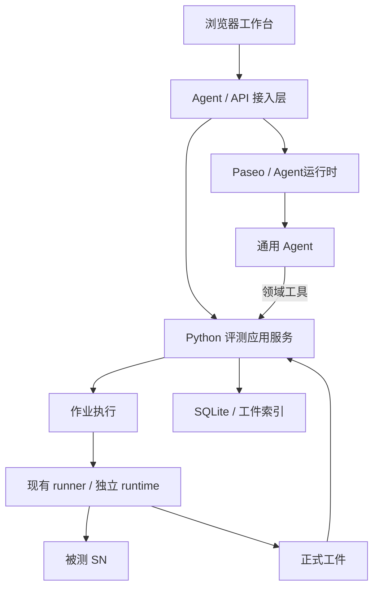

# 技术选型方向与实现参考 v0.4

2026-10-11 修订。本文记录当前推荐路线、源码观察和待实现验证的选择，供开发使用；不冻结技术栈、部署形态或功能分期。Paseo 参考提交为 `6ec663342554bb9c9b50a5e91954aa54e7eb7877`，不是线上最新版声明。

## 产品方向与选型建议

用户已明确：单服务器可访问 SN；workspace／worktree 组织工作；通用 Agent 可参与评测、调查、修改和验证；界面与技术尽量向 Paseo 对齐；保留手动操作与历史。

当前优先考虑独立 Web 工作台，通过 Paseo 公共 SDK 复用 Agent 能力，保留 Python 评测核心。它便于组织跨会话的任务与正式结果。插件、组件复用或更直接的 Paseo 集成仍可在开发中比较；发现更省力、更贴合体验的方式时调整路线，不以本稿排除它们。无需先把所有选项确定，再做第一个可用工作面。

## 独立工作台与插件的取舍依据

本地插件公开契约提供 screen、sidebar header／footer、workspace／agent panel 和时间线扩展；未发现向原生 workspace 分组插入本项目持久 Task 子节点的专用入口。插件可以自行建立 screen 和导航，因此这不是插件无法承载评测的证明。

独立应用便于拥有任务导航和材料阅读；插件可能减少界面及会话整合成本。当前推荐独立应用，但应结合实际接入成本和界面体验决定，不同时把两条路线完整建设一遍。

证据（路径相对 `/home/wabiwabi/paseo`）：

- `packages/plugin/src/client/contracts.ts`：插件客户端与面板契约。
- `public-docs/plugins/reference.md`：Screens、Workspace panels、Timeline items。
- `packages/app/src/components/sidebar/sidebar-projection.ts`：原生导航投影。
- `packages/client/README.md`：包根公共 SDK 与私有 `internal/*` 的边界。

## 技术参考

| 层 | 当前建议 | 已观察的版本与考虑 |
| --- | --- | --- |
| 前端 | TypeScript、React、Expo Router、React Native Web | Paseo 锁文件：TS 5.9.3、React 19.1.0、RN 0.81.5、RN Web 0.21.2、Expo 54.0.33、Router 6.0.23；用于对照，应用自己的兼容版本在接入时确定 |
| 样式／组件 | 参考 Unistyles、主题 tokens 和共享控件 | Unistyles 3.2.4；尽量复用成熟的控件、几何和状态处理，复制代码保留许可并处理内部依赖 |
| 状态 | Zustand＋TanStack Query | 5.0.11／5.90.21；区分界面状态与服务端事实，具体 store 划分随组件形成 |
| TS 数据校验 | Zod | 4.4.3；前端与接入层可共享格式，服务端保留独立校验 |
| Agent 接入层 | Node.js＋TypeScript，Express 是候选 | Paseo 参考 Node 22／Express 4.22.1；是否独立网关、怎样转发由实际 SDK 接入决定 |
| Agent | Paseo daemon＋`@getpaseo/client` | 参考 package 0.11.2；以实际使用的 SDK／daemon 组合为准，不要求与参考提交永久相同 |
| 评测服务 | Python ≥3.11；FastAPI 是 HTTP 层候选 | 复用现有 Python 核心；HTTP 层、worker 的具体进程划分在实现中确认，FastAPI 尚未安装或锁定 |
| 评测与存储 | 现有 scorer、DeepEval 4.2.2、SQLite 与工件 | 保留官方分、人评与分析的来源；复用已有比较器 |
| Agent 工具 | MCP 或适配后的领域命令 | MCP SDK 参考 1.29.0；接入方式取决于实际 provider 能力，不预设所有 Agent 都支持同一工具协议 |

表中新增依赖的版本是参考值，不是必须逐项匹配的清单。实现时记录实际依赖与来源，遇到兼容问题可调整；无需每次调整都重做整套设计。现有评分协议所要求的依赖身份仍随结果保存。

## 单服务器的建议职责图

图表达责任，不要求每个框都单独部署为一个服务。评测计算留在现有 Python 层；会话能力优先复用 Paseo；界面、CLI 和 Agent 使用一致的领域操作，减少重复逻辑。HTTP／SSE 是当前通信建议，事件流形式可以随 SDK 接入调整。

模型密钥和 daemon 凭据留在服务端。接入层校验操作者、目标及实际委托范围；具体认证、令牌和路由机制在对应模块实现时明确，而非在本稿预定所有细节。

## 已观察的能力与待解决问题

| 源码观察 | 对实现的影响及候选处理 |
| --- | --- |
| SDK 支持 create/ref/send、历史读取、订阅及权限响应 | 可作为会话接入起点；重连需要核对历史，不能假定事件自动补齐 |
| 参考 SDK 没有独立 `interrupt()` handle 方法 | 可评估公开 CLI 停止指定 Agent，或接入时可用的新公共能力；停止结果以实际状态为准 |
| 任意外部会话导入未在参考 SDK 中确认 | 先核对实际能力；关联已有会话或创建会话是可行起点，不因此永久排除导入 |
| `timeline.append()` 属于插件接口 | 独立应用不能直接当作 SDK 通用方法；会话与领域进度可以在自己的视图组合，若走插件路线再评估其渲染入口 |
| provider 的 MCP、权限、恢复与 usage 能力不同 | 展示真实能力并选择合适的接入方式；一种机制不可用不等于该 Agent 整体只能只读 |
| 相同 cwd 不保证独占写入 | 改码与评测需要核对并发编辑及实际运行源码；锁、快照或隔离目录是可评估手段 |

能力证据：`packages/client/src/index.ts`、`public-docs/sdk/events.md`、`packages/cli/src/commands/agent/stop.ts`。这些是参考版本的事实，接入时可以重新核对。

## worktree 与源码捕获

workspace 可以指向现有 checkout／worktree；是否另建 worktree、直接复用当前目录或捕获独立执行树，取决于用户当前工作和实现成本。设计阶段不规定统一默认，也不要求每次改码都经过相同的确认步骤。

当前 `runtime_environment.snapshot_sources` 拒绝 tracked dirty 源码，`configure_environment` 从传入 project 的 backend 加载。**这是现有 runner 的待解决问题，不是产品对未提交改动的禁用要求。** 目标仍是让用户验证 Agent 的实际修改，并记录究竟运行了哪些内容。

可从已有 clean 对象先接通执行，也可在首个流程中补源码捕获；分期随开发证据调整。捕获应覆盖实际使用的改动与必要文件，密钥和运行配置另行处理，避免以 HEAD 冒充带改动的版本。是否采用 source manifest、怎样识别外部编辑，以及写入协调方式，留到该边界实现时决定；不为评测偷偷提交用户分支。

## 开发中的更新方式

先用一条真实工作路径推进界面和接入，按实际问题调整技术与模块。影响评分来源、运行身份或历史解释的改变同步记录；布局、组件合并、参数命名等局部调整不需重新审批整套文档。MLflow／Langfuse 保留为可能的反馈适配，不要求先完成选型才能开发。
