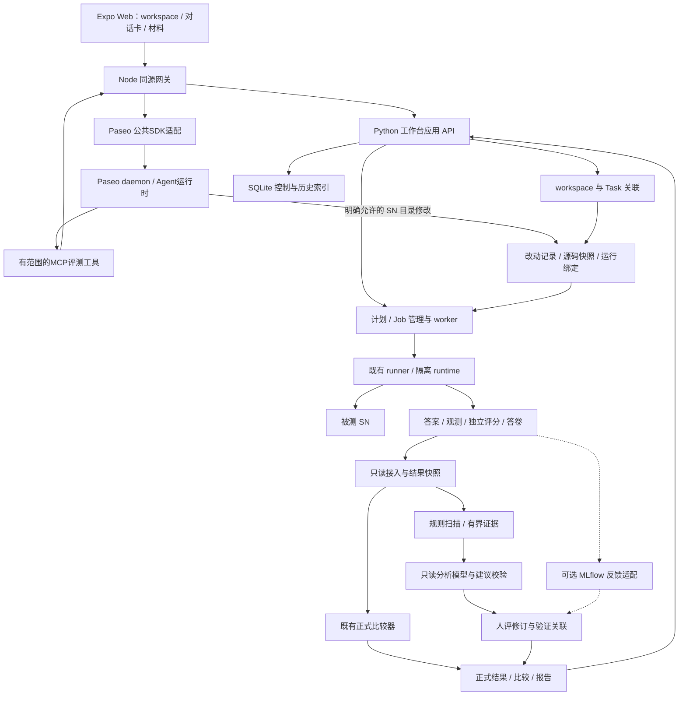
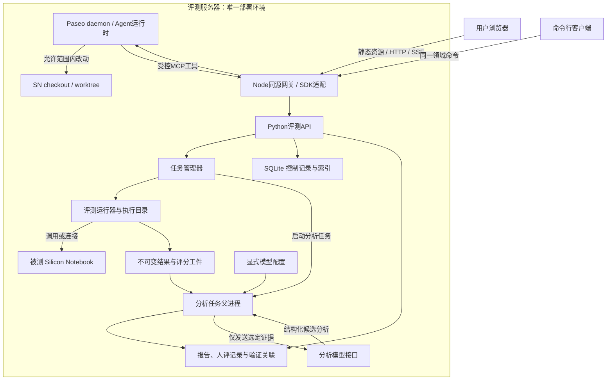
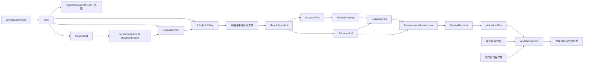
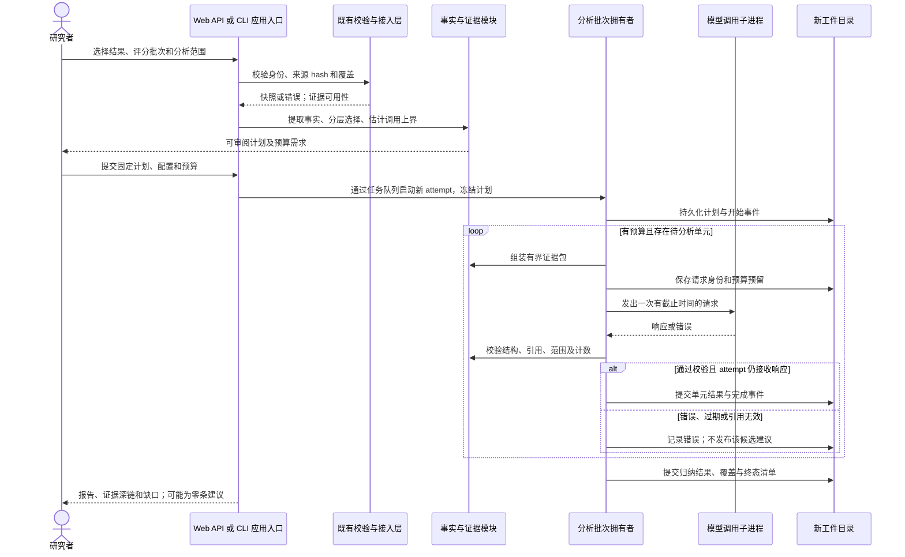
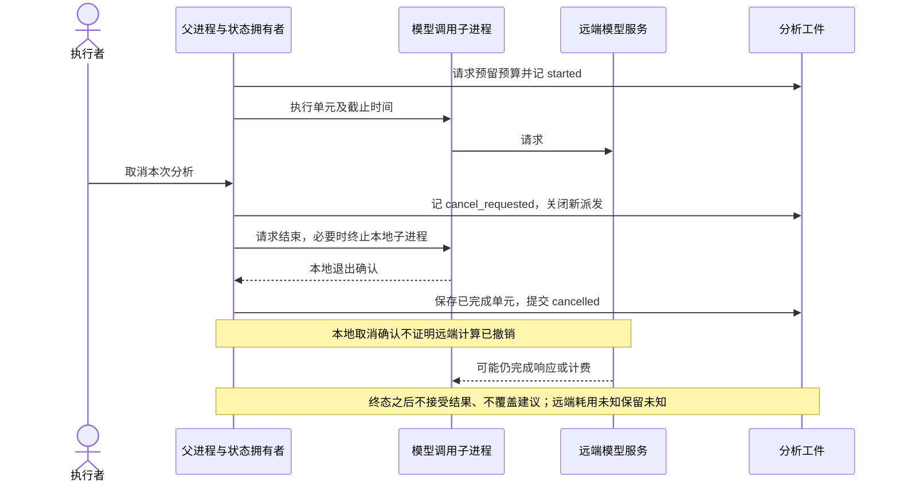
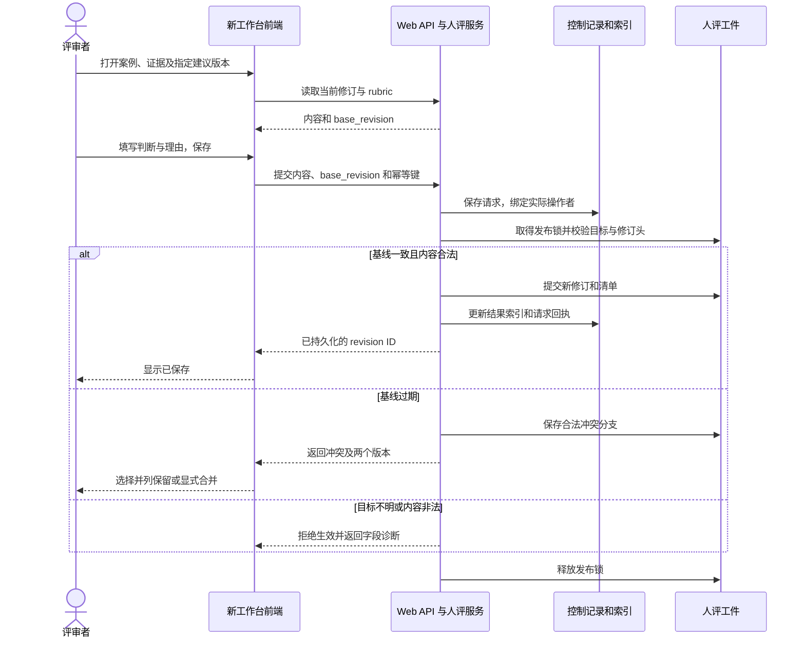
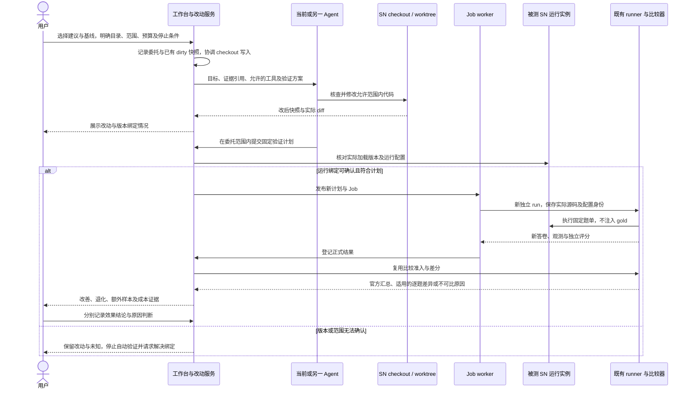
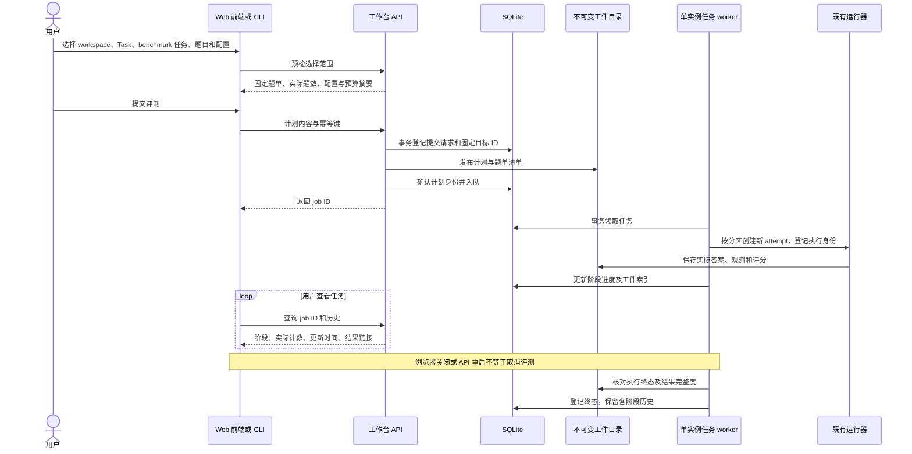
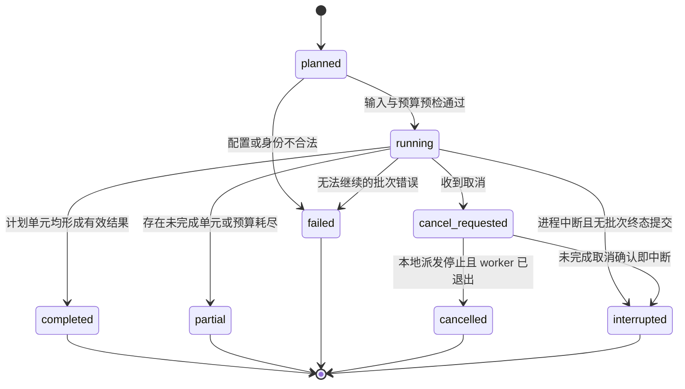

# Silicon Notebook 评测与改进工作台：技术方案

版本：v0.4；日期：2026-10-11（修订）；状态：持续演进的架构参考。

产品依据：[PRD v0.4](../../evaluation-improvement-workbench-prd.md)。既有评测代码核对基线（本轮只核对 Git 身份，不重新验收实现）：本地 `feat/benchmark-protocol-correctness`，HEAD `bdc22e2`。本文中的新增模块、接口、格式及流程均为设计建议，尚未实现或验收；已有能力另行标识。服务器运行状态本轮未核实。

本文交付整体架构、技术选型、模块与数据契约、关键时序和验证安排。当前实验仍遵守 [CURRENT_STATE.md](../../../CURRENT_STATE.md)：SN-only 五套 chunk 加 MultiHop reasoning；建议分析模型与新增验证实验需要另外明确执行范围。本稿不启动实现、模型调用或部署。

## 方案的使用方式

本文的组件图、模块、接口、存储机制及分期用于启动开发，可根据真实接入与使用反馈调整。优先借鉴 Paseo 的技术和界面细节，尽早形成可用工作路径；不要求先锁定全部依赖、卡片和路由。已有评分、来源与历史真实性继续保持；当前代码限制标为待解决问题，不直接固化成产品限制。

## 1. 设计结论

采用 **单服务器 AI 协作工作台＋Python 评测服务＋Agent 运行时＋不可变工件**。workspace 绑定 SN 目录／worktree 及运行配置，Task 保存持续目标，Agent 会话承担协作，Job 管理评测及分析的实际执行。用户可手动操作，也可明确委托 Agent 制定计划、运行评测、调查、修改 SN 并验证。只读 `AnalystClient` 与可执行工具的 Agent 分开。

闭环为：**workspace 中建立目标 → 手动／Agent 制定计划 → 受管理作业 → 正式结果与证据 → 候选建议及人工判断 → 有界修改 → 核对实际被测版本 → 新作业验证与比较**。单份 SN 结果即可进入分析；外部比较是另一种输入。

产品方向与当前方案：

1. 五套协议、官方 scorer、DeepEval 组件／轨迹评分、既有比较器继续各负其责。分析层只引用结果，不重新定义成绩。
2. 新增分析批次、人评修订和验证关联采用版本化文件。工作台使用轻量 SQLite 保存草稿、任务控制记录、操作历史和工件索引；正式计划、结果、人评和分析输出发布为版本化工件。两者的权威职责见 §6。暂未发现需要额外队列或向量数据库的证据；规模变化时可重评。
3. 模型接收有界、可定位的证据包，返回结构化假设、动作和证伪方案；确定性校验拦截错误引用，人工判断语义支持与行动价值。
4. Web 工作台是正式应用入口。CLI 继续提供同等业务命令以及调试、故障恢复能力，二者调用共同应用层。模型调用由评测服务器发起。
5. 当前推荐独立 Expo Web＋Paseo 公共 SDK，复用 provider／会话，保留 Python 评测核心。网关职责、插件接入或组件复用在开发中比较，不将当前方案冻结为唯一承载方式。MLflow 保留可选。
6. 左侧组织 workspace 与任务，中间承载会话、目标及结构化工作卡，右侧按需展开材料。资源设置容纳 benchmark 目录及协议详情，选题仍在任务内直接可达。
7. Agent、Task 和 Job 状态分别归属；关闭会话或面板不取消受管理作业。版本依据实际源码快照与 SN 运行绑定，不依据当前分支显示。

### 1.1 当前推荐的承载路线

优先尝试独立工作台＋Paseo 公共 SDK，技术尽量参考 Paseo 的 React／Expo Router／React Native Web／Unistyles／Zustand／TanStack Query／Zod；具体组件和依赖按实际需要取用。Node网关连接同机daemon并转发Python领域命令；不是再建设一套Agent进程管理。具体版本和依据见[技术决策](../../product/sn-workbench/technology-decisions.md)。

Paseo插件具有screen、sidebar header／footer、workspace／Agent面板和时间线扩展，未提供本项目需要的原生workspace分组下独立Task子节点契约。自行在插件screen中再建完整工作面会增加导航层，因此暂不作为主路线。此结论是设计取舍，不是“插件不可实现评测”的断言，也不是SDK兼容性验收。

手动、CLI 与离线报告继续保留。当前 runner 拒绝 tracked dirty 源码，需补稳定捕获及实际运行绑定；clean 源码可作为接入起点，dirty 能力何时补齐由开发路径决定，不预设只能后置。

## 2. 当前实现与扩展落点

| 现有模块／入口 | 已核对的职责 | 新设计如何使用 |
| --- | --- | --- |
| [notebook_bundle.py](../../../src/rag_eval/notebook_bundle.py)、[run_reader.py](../../../src/rag_eval/run_reader.py) | 冻结输入校验；`RunReadContext` 在一次操作中复用已校验输入 | 统一接入边界调用；不跨操作信任旧校验收据 |
| [benchmark_submission.py](../../../src/rag_eval/benchmark_submission.py) | 答卷身份和预测校验、SN 答卷导出 | 分析只消费已导出结果；不隐式导出或重评 |
| [benchmark_comparison.py](../../../src/rag_eval/benchmark_comparison.py) | `compare_submissions` 检查范围、scorer、分母，计算正式差分与适用的统计 | 复用比较结果和准入逻辑；单结果分析不调用要求至少两份答卷的接口 |
| [benchmark_review.py](../../../src/rag_eval/benchmark_review.py) | `write_review` 复核比较来源，分层抽样，导出案例与空白标注 | 保留既有配对抽样口径，增加单结果选择器和人评导回 |
| [experiment_aggregation.py](../../../src/rag_eval/experiment_aggregation.py)、[explorer_artifacts.py](../../../src/rag_eval/explorer_artifacts.py) | 从 run 构建离线页面与详情；正式比较尚为另一条输出路径 | 复用读取与证据契约，必要时提取纯数据逻辑；新前端独立实现，不扩展旧页面 |
| [model_adapter.py](../../../src/rag_eval/model_adapter.py) | `ExplicitBenchmarkModel` 是 DeepEval 适配器，只接受 tested／judge 角色 | 借鉴显式配置和迟到响应处理；新增 analyst 接口，不冒用 judge 身份 |
| [run_results.py](../../../src/rag_eval/run_results.py)、[artifacts.py](../../../src/rag_eval/artifacts.py) | `EventJournal` 独占创建、线程内串行、逐条 fsync；完整文件替换写入 | 复用基础能力；新批次另定义发布规则，不宣称已有跨文件事务 |
| [artifact_store.py](../../../src/rag_eval/artifact_store.py)、[result_package.py](../../../src/rag_eval/result_package.py) | 共享输入／源码对象、results／review 角色包 | 只读解析来源；新增分析包清单，不假定原打包器已识别新目录 |

当前 `pyproject.toml` 要求 Python ≥3.11，核心依赖为空；DeepEval 是固定为 4.2.2 的可选依赖。离线读报告不应因本设计强制加载 DeepEval 或模型 SDK。

现有 Dashboard 是旧的离线报告阅读器。新工作台不在其上继续堆加功能。旧的静态 HTML 可作为历史导出物继续阅读；新任务、结果、建议、历史和人评进入新工作台，不要求长期维护两套界面。迁移完成后可以删除旧 Dashboard 入口，但不能删除其引用的原始工件。

## 3. 整体结构与部署边界

本轮同步workspace／Task／会话／材料面板与专用工作卡，见[设计与开发参考](../../product/sn-workbench/README.md)。新版可点击原型为构造交互参考，尚无浏览器渲染或用户可用性验收；Paseo目录的v0.2原型保持历史预览。

### 3.1 组件图

实线为主流程，虚线为可选接入。图中的“新增”表示待实现。



Agent 工具调用只提交结构化意图；评测服务拥有计划发布、幂等提交、作业和工件校验。编码 Agent 可以在允许目录写 SN，不能取得评测工件写入权。前端会话事件与结果查询是两条通路，均关联稳定身份。

### 3.2 运行位置



单服务器承载Expo Web静态资源、Node同源网关、Python API、单实例评测worker、Paseo daemon、SQLite和工件目录。内部服务不直接暴露给浏览器；具体认证及秘密配置见技术决策。评测系统可访问被测 SN；同机 SN 为默认拓扑，也可接入已配置的 SN 服务。SN 访问沿用可记录的评测接口；只读分析模块不改写 SN。编码 Agent 仅在明确 SN 开发目录操作，实验数据与生产数据保持隔离；运行器核对代码快照和被测运行实例，不把磁盘修改自动视为已加载。评审者的浏览器只是访问端，不承载权威工件，也不构成另一套评测环境。任务 worker 启动的分析父进程拥有批次状态与预算，模型调用子进程只持有选定请求及必要凭据；子进程不能写原始结果或发布正式分析。报告不含凭据、不访问模型、不加载 CDN。

## 4. 模块划分与依赖

下列为**拟新增**的 `src/rag_eval/improvement/` 包和 `src/rag_eval/workbench/` 服务模块。按职责划分模块。Web 服务只负责工作台操作和状态，不重新实现评分逻辑。

| 模块 | 输入 → 输出 | 独占职责及失败行为 |
| --- | --- | --- |
| `contracts.py` | JSON ↔ 类型化记录 | 格式版本、必填字段、finite JSON、枚举与引用形状；非法记录拒绝 |
| `ingest.py` | 显式工件清单 → ResultSnapshot | 调用既有 reader／协议校验，绑定来源身份；内容冲突拒绝，材料缺失按能力降级 |
| `evidence.py` | Snapshot、case 引用 → EvidencePacket | 定位原文、映射阶段、截取预算与缺口；不补造未观测阶段 |
| `diagnosis.py` | 原分数、状态、观测 → Facts、Selection | 确定性事实规则和分层选择；分数异常是调查触发，不自动标注错误 |
| `analyst.py` | EvidencePacket、AnalysisConfig → 候选结构化分析 | 模型边界、配置身份、响应解析；不运行工具、不访问任意源码 |
| `analysis.py` | Plan、分析单元 → 新分析批次 | 单一状态写入者，预算、子进程、checkpoint、取消、完成发布 |
| `recommendations.py` | 单案分析、反例、事实 → 建议版本 | 引用校验、有限归并、未知与替代解释保留；不替人确认根因 |
| `reviews.py` | Web 提交／草稿包、既有人评 → 新修订 | 身份校验、修订关系和冲突；工件提交后才返回保存成功 |
| `validation.py` | 建议、人评、基线、新结果 → 方案及验证关联 | 冻结方案、关联修复与比较结果；不执行实验、不重复差分计算 |
| `report.py` | 明确选择的工件版本 → JSON／Markdown／HTML | 完整覆盖、成绩、建议、证据深链；显示选定版本与未决事项 |
| `storage.py` | 新工件及引用 → 发布目录和收据 | 新目录、单写者、hash 清单、提交标记、稳定读取；不成为实验调度器 |
| `workbench/api.py` | 前端请求 ↔ 工作台命令 | 校验用户请求，创建计划，查询历史，提交人评；不直接写 run 文件 |
| `workbench/plans.py` | 前端选择 → EvaluationPlan | 固定题目、配置、预算和输入版本；计划发布后不可变 |
| `workbench/repository.py` | 命令 ↔ SQLite 事务 | 保存草稿、幂等请求、作业控制、取消意图、标签及操作审计 |
| `workbench/jobs.py` | EvaluationPlan ↔ 独立 run | 启动、监控、取消和恢复执行进程；只接受已记录的终态和工件 |
| `workbench/workspaces.py` / `tasks.py` | workspace 位置及目标 → 稳定身份与关联 | 管理位置、目标和跨作业导航；不从 Agent 状态推断任务完成 |
| Python session／scope关联＋Node gateway的SDK／MCP适配 | provider会话及结构化意图 → 关联、回执 | Python持久范围，Node使用公共SDK；不重写provider进程管理，不另建Job队列 |
| `workbench/changes.py` | checkout、diff、运行信息 → ChangeSet、SourceSnapshot、RuntimeBinding | 保留已有 dirty 内容与改动来源，协调写入，核对实际加载版本；未知不伪装确定 |
| `workbench/resources.py` | 配置与五套协议索引 → 资源视图 | 提供 benchmark／Agent／SN 配置及来源；不重复定义 scorer |
| `workbench/history.py` | 工件引用 ↔ SQLite 结果索引 | 查询、分页和过滤历史；区分可重建结果索引与须备份的用户记录 |
| `apps/sn-workbench/` / `apps/workbench-gateway/` / `apps/workbench-contracts/` | 视图／事件／命令 → 工作面及工具回执 | Expo Web、Node窄网关和Zod契约各自负责；界面不执行评分或获得工件写权限 |
| `adapters/mlflow.py`（可选） | 工件 ↔ 平台记录 | 幂等映射、反馈导回；平台分数不得回写官方分数 |

依赖方向：Web API／CLI → 工作台应用模块 → 契约与既有读／比较模块。Agent 工具、页面与 CLI 均提交结构化操作；页面另订阅 Agent 事件；`diagnosis.py` 不导入模型库；任务管理器调用已有 runner；平台适配器依赖核心契约，核心不依赖平台。

既有 `_validate_scores`、`_selection`、`_observed_evidence` 是内部函数。实现时优先通过现有公共入口取得已验证产物；确需单结果共用时，将所需职责提取为窄公共函数，并保持原入口行为与反例测试。新模块不复制这些逻辑，也不跨模块长期依赖下划线私有接口。

### 4.1 拟定应用接口

以下为Web、CLI和Agent工具共用应用操作。具体首切片HTTP、DTO、revision、SSE和错误契约见[接口与事件](../../product/sn-workbench/api-and-events.md)，尚不可调用。长任务返回job ID，不在HTTP请求内等待实验完成。

| 操作 | 必须显式给出的参数 | 返回／副作用 |
| --- | --- | --- |
| `register_workspace` / `create_task` | 目录／worktree、SN 配置；目标、workspace ID | 服务端登记稳定身份及关系；不启动实验 |
| `attach_agent` / `handoff_agent` | task ID、provider/session、能力与委托范围 | 会话引用及交接包；不自动扩权，导入能力以 provider 为准 |
| `record_change` / `bind_runtime` | 源码快照、diff、执行者；实际运行实例与代码证据 | 改动关联与版本核对；无法核对保留未知 |
| `list_cases` / `freeze_selection` | bundle、task、筛选／显式选择／seed | 分页题目及固定 case IDs；不裁剪公共材料 |
| `save_plan` / `submit_plan` | 输入版本、固定题单、配置引用、预算、幂等键 | 草稿或已提交计划，返回 job ID；重复请求返回原任务 |
| `get_job` / `cancel_job` / `retry_job` | job ID、期望版本；重试目标范围 | 查询、取消请求或新 attempt；不覆盖原 run |
| `list_history` / `save_review` | 筛选、cursor；目标版本、base revision、评审内容 | 历史列表或持久化人评回执；冲突显式返回 |
| `inspect_results` | 来源清单、答卷及评分批次、可选比较／发表参考 | 只读返回验证结果与能力缺口 |
| `build_analysis_plan` | snapshot、范围、选择规则／seed、证据预算 | 写新计划，列候选数与预计调用上界；不调用模型 |
| `run_analysis` | 已冻结计划、模型配置、调用／token／时间上限、新目录 | 生成新分析 attempt；可用显式父批次引用复用已完成单元 |
| `export_review` / `import_review` | 明确目标版本、rubric、评审者／草稿包 | 导出任务或提交新人评批次及冲突清单 |
| `create_validation_plan` / `link_validation_results` | 人工选择、基线、题单／控制条件；实际新结果 | 新验证计划或新比较关联；不启动 SN |
| `build_report` | snapshot、analysis、review、validation 的明确版本 | 新离线报告与输入清单；无需模型依赖 |

禁止以扫描最新目录、取最高分或文件修改时间来隐式选择评分批次。历史建议检索首版按 suite、task、问题类型、适用源码版本和人工状态筛选，不增加语义向量索引。

### 4.2 工作台命令与查询边界

前端和 CLI 均可提交评测、评分／补评、分析、比较和验证任务，以及保存人评和查询历史。它们共用同一应用服务；界面不要求用户复制命令完成正常流程。CLI 托管模式经同一 API 提交，既有直接执行脚本作为兼容入口保留，其结果显式导入后可查询，但不会自动取得进程控制权。

- 题库查询按 bundle、task 分页。筛选、逐题选择和抽样在后端解析为固定 case IDs，保存规则、seed、题单 hash 与总数；跨页选择不能仅提交当前页面内容。
- 配置使用服务端登记的模型、SN 接入和评分 profile ID；前端不提交任意 shell 命令、文件路径或模型凭据。worker 执行前重新核对配置版本、源码对象及实际运行绑定与计划冻结值。评测期间源码／运行绑定必须稳定；若已确认变化，记录偏离并停止后续派发，不能继续报告为同一固定版本。clean 私有执行树是可用起点；dirty 捕获及外部 SN 加载证据随执行接入补齐，具体分期可调整。
- 提交命令携带幂等键，同一键和相同内容返回同一个 job，不重复调用模型；同一键但内容不同返回冲突。用户主动“再次运行”才使用新请求键和新 attempt。
- 计划列明生成、答卷投影、正式评分、分析等阶段及依赖。补评引用已有答案，分析引用稳定结果快照，失败后不隐式重新生成。
- 查询返回阶段、计数、更新时间和是否待核对。领域变更采用持久outbox＋HTTP/SSE、断线补读及查询校验；Agent采用Paseo epoch/seq，经Node适配补读。两条游标不混用，卡片派生正式对象，不另存成绩。关闭连接不改变Job。
- Web 人评与文件导入调用同一个修订服务；正常界面保存不需要手动下载／导回文件。

### 4.3 作业管理与现有 runner 的关系

作业管理器按 plan 拆为 partition × mode × attempt；每个 run 使用新的目录与隔离 runtime。选题只限制执行的问题，仍保留所属分区完整公共资料。一个 Task 可以关联多个 Job，每个 Job 可以对应多个 run 和评分／分析批次。Task 的目标状态不由进程退出自动决定；历史显示此关系，不能把子进程数当题数。

任务 worker 是独立于 Web API 生命周期的同机进程。首版只有一个活动 worker，数据库事务原子领取任务，实际运行采用独立进程组。API 不持有评测长请求。默认有界串行执行，避免未经测量就争用 SN 和模型资源。

启动使用持久化的 step ID 与 attempt 路径。子进程入口取得该 step 的执行锁，写入 owner、进程启动身份和 run 绑定，再进入 runner。派发成功但确认丢失时，恢复进程先检查锁、进程身份和工件；不能仅因 PID 不存在、心跳过期或 HTTP 超时自动重跑。无法确认的任务显示待核对，暂停该 step 的自动派发。

重启 API 不重启 worker。重启 worker 后核对仍在运行的子进程：确认有效就继续监控；确认退出则读取工件归档状态；确认无终态时记 interrupted，显式重试创建新 attempt。执行锁不能只靠超时抢占，不把“只启动一次”的理想目标写成远端模型恰好调用一次的保证。

取消由用户请求驱动。排队阶段取消会阻止领取；运行阶段停止后续 step，并向当前进程组请求退出。旧 runner 是否能在题目边界停止须逐入口验证；不承诺当前题一定完成。等待有界退出后才能确认 cancelled，必要时强制结束本机进程，保留已落盘结果并标明当前题未完成。远端服务是否撤销计算另记未知。完成先于取消提交时，取消返回“任务已结束”，不覆写完成终态。

评测执行状态与结果完整度分开：runner 正常退出不等于官方评分已完成。任务阶段结果可为成功、部分完成、失败或取消；页面另列答案、投影、评分与分析各自覆盖。请求不存在的题目、零题计划、过期配置或不兼容 scorer 应在启动前拒绝并解释原因。

### 4.4 交互设计阶段的接口澄清（2026-10-10）

**统一历史查询。** `history.py` 对任务、结果、规则扫描／模型分析、建议、人评、验证和导入记录提供跨类型投影，支持类型、时间、状态、benchmark 和关联对象筛选。列表条目包含稳定条目 ID、来源类型及 ID、事件类型、原事件时间、登记时间、版本、关系和可打开的目标。历史导入保留原时间的已知／未知状态，不用导入时间冒充实验时间；分页采用稳定排序键和 cursor，不假定不同来源的时间戳证明全局因果顺序。

统一时间线和按类型分组可以使用同一查询契约，不必为了页面布局建立第二套历史。SQLite 中的控制事件／用户记录仍需备份，工件派生的结果条目可重建；重复登记同一来源事件不重复计数。历史按业务事件展开，不逐条展示心跳和轮询。列表中的状态摘要与“该时刻发生的事件”分列，避免当前状态看起来属于过去。

**问题视图与规则扫描。** 首版不增加独立的 `Problem` 生命周期或第二份可编辑事实库。`diagnosis.py` 将确定性扫描发布为 `DiagnosisScan` 工件，保存输入 snapshot、规则及配置版本、实际扫描 case IDs、覆盖／缺口、Facts 与命中分组。界面“问题”是该工件的投影；条目稳定引用 scan ID 与规则／case／fact 身份。规则改变或输入评分批次改变产生新 scan，不覆盖旧列表和计数。历史页将规则扫描与模型分析标为不同类型。

规则扫描无需调用模型，可以先于模型分析计划独立执行；AnalysisPlan 明确引用选用的 scan。用户进入结果页可以看到“尚未扫描”，并发起扫描，而不必先提交有模型预算的分析。模型原因假设和人工发现各自引用 CaseAnalysis／ReviewRevision，可在问题视图分层展示；它们不能伪装为规则全量命中。以后需要跨版本问题合并、责任人和独立处理状态时，再评估新增问题实体。

浏览器临时输入缓存与服务端“保存草稿”分开：用户点击保存须收到持久化版本回执；本地缓存失败不能静默显示已保存。普通保存、创建空白草稿或导航无需额外确认弹窗。产生模型调用的提交应显示范围和预算，由一次明确提交完成；不能因所有动作都会创建记录就统一增加二次确认。

### 4.5 Agent 与改动边界

- Node接入适配拥有公共SDK与能力映射，Python保存Task/session关联及授权范围；会话事实由Paseo/provider提供。工作台不把 provider 的会话待办（Paseo `AgentTaskItem`）当作正式 Task／Job。
- Agent 工具经 API 提交已授权计划，返回 job ID 和可解析工件引用；请求超时先查同一幂等键，不自动重新生成。Agent 可以继续监控，也可离线，worker 仍独立运行。
- `AnalystClient` 无工具权限；编码 Agent 可以在明确目录使用授予的工具。两者的模型身份、输入范围、预算和结果分开记录。
- 同一物理 checkout 上的写入按 checkout 身份协调，不按 workspace ID 假定隔离。方案至少需要明确写入者及作用期、暂停／交接与未知 owner 处理；Paseo 当前共享 cwd 的会话能力不提供本项目单写者保证。
- 现有 `snapshot_sources` 拒绝 tracked dirty 源码，`configure_environment` 从传入 project/backend 加载。这是需解决的实现缺口；源码捕获、执行树及 source manifest 是候选手段，分期随开发调整。实际运行内容保持可核验，不隐式提交用户分支。

## 5. 数据模型与身份

### 5.1 身份原则

- 继续引用现有 `bundle_id`、`case_id`、`run_id`、`submission_id`、`scores_id`、比较 `report_id` 和原生 span/sample ID。新增对象不重新命名这些身份。
- `ArtifactRef` 保存角色、原格式、逻辑 ID（若有）、原始字节 SHA-256 和包内相对位置。路径是定位方式，内容身份不依赖绝对服务器路径。
- 新内容 ID 复用 `identity.fingerprint` 的确定性序列化，明确 `format` 及 hash 覆盖字段。hash 自身和可迁移 locator 不进入该内容 hash；文件字节 hash 另存于清单。
- 一个来源同时有逻辑 ID 与 hash 时两者均校验。同 ID 不同内容拒绝合并；同内容不同位置可以登记多个 locator，不增加案例数。
- 缺 run 的公开答卷仍可引用 submission；只有发表汇总时只建立 ReferenceEntry，不伪造 AnswerRef、run 或逐题记录。

证据引用的文本范围统一为原始 UTF-8 字节的半开区间；结构化内容先以记录主键和 JSON pointer 定位，再对字段值记录片段 hash。展示行号只作阅读辅助，不能独自证明引用身份。保存完整性为 unknown 的检索记录不能支撑“所有检索都没有包含某信息”的否定断言。

### 5.2 对象契约

| 对象 | 关键字段（建议） | 所有者与约束 |
| --- | --- | --- |
| `EvaluationPlan` | workspace／task 引用、源码／运行绑定、bundle、固定 case IDs／hash、选择规则、mode、模型／scorer 配置引用、预算、plan hash | 提交后不可变；拆分为多个独立分区 run，gold 不进入生成请求 |
| `Job` / `JobStep` | job ID、plan hash、kind、attempt、parent、step、run refs、request key、状态版本、取消意图、owner/process identity | 任务管理器拥有控制状态；执行观察来自 worker 和工件；一项计划可关联多个阶段和 run |
| `WorkspaceRecord` | 稳定 workspace ID、仓库身份、cwd、worktree、分支、SN profile、位置修订 | SQLite 保存可变位置及配置；目录不是评测版本，多个 workspace 可能指向同 checkout |
| `Task` | task ID、workspace、目标、计划／Job／结果／改动／会话引用、人工状态 | 持久目标与关系；可跨会话及多次运行，不等于 benchmark task 或 Job |
| `AgentSessionRef` / `DelegationScope` | provider/session ID、能力、task 关系、工具／目录范围、预算、停止条件、交接引用 | 会话由 Agent 运行时拥有；工作台保存关联与委托，不声称任意 provider 均可恢复或导入 |
| `SourceSnapshot` / `RuntimeBinding` | 源对象 hash、commit、dirty 内容引用；运行实例、配置、实际加载版本及核对证据 | 代码快照不可变，运行绑定按执行记录；未知保持未知，不仅保存 Git diff 或 cwd |
| `ChangeSet` | task、执行者、基线、改后快照、已有 dirty 内容、实际 diff、范围与理由 | 关联本次开发变动，保留用户原改动；生成补丁不代表已应用、提交或部署 |
| `DraftRecord` | 目标对象、操作者、草稿内容、版本、标签／收藏 | SQLite 持久化用户输入；浏览器临时缓存不能承担保存责任 |
| `ResultSnapshot` | `snapshot_id, source_refs, selected_score_refs, case_scope, coverage, capabilities, captured_at` | 接入层；正式指标保留原值、单位、eligible 题单、分母、scorer 来源 |
| `CaseRef` / `AnswerRef` | bundle＋case；submission＋case，或经校验的 run＋case＋输出 hash | 接入层；同一题的不同答案分开，组件次数不增加题数 |
| `EvidenceRef` | artifact hash、record key、JSON pointer／文本范围、excerpt hash、completeness、角色 | 证据层；记录引用的是回答、gold、真实观测、人评还是源码 |
| `Fact` | `fact_id, rule_version, subject_refs, predicate, value, evidence_refs` | 规则层；可重算的观察事实，不含模型生成的因果断言 |
| `DiagnosisScan` | scan ID、snapshot、规则与配置版本、扫描题单、覆盖、Facts、命中分组 | 确定性诊断；独立无模型工件；问题视图及分析计划引用它 |
| `AnalysisPlan` / `AnalysisAttempt` | 输入 hash 集合、selection、预算、代码／prompt／模型身份；attempt ID、parent、单元结果和状态 | 分析编排器；同计划的重试仍是新 attempt |
| `CaseAnalysis` | facts 引用、hypotheses、support／counter evidence、unknowns、下一步、call 引用 | 模型候选；结构有效不代表语义成立 |
| `Recommendation` | 稳定建议 ID、revision hash、适用条件、支持／反例、动作、最小试验、否定条件、代价及优先级依据 | 建议模块；引用明确分析版本，不推断未分析总体 |
| `ReviewRevision` | review ID、revision ID、parent、target refs、reviewer、rubric hash、判断、理由、evidence、时间 | 人评导入器；旧版本永不覆盖；rubric 变化须显式迁移／重新评审 |
| `ValidationPlan` / `ValidationRecord` | 建议／人评版本、基线、目标与保留样本、拟改变因素、scorer、验收标准；实际代码、结果和比较引用 | 验证模块；拟定与实际执行配置同时保留 |
| `ReportManifest` | 上述输入版本、renderer 版本、文件清单、报告 hash、限制 | 报告生成器；新反馈不静默改变旧报告 |

分析类新格式采用 `evaluation-improvement-<kind>-v1` 命名；工作台计划和作业契约单独版本化；这是建议中的新契约，不修改既有格式。未知版本拒绝语义分析并报告所需适配，不能猜字段。以后升级由显式转换器输出新对象，保留源 hash；不原地升级历史数据。

### 5.3 关系图



一个 workspace 有多个 Task；Task 可关联多个 Agent 会话与 Job，外部答卷／导入结果可以没有本地 run 或会话。同 checkout 不等于同 workspace，同 workspace 不等于同源码版本。

一个建议可有多个分析案例、多个人评和多次验证，不强制一一对应；同一验证也可关联多个建议，但必须说明多个改动使单一原因归因受限。修订通过 parent 连接，不自动迁移旧人评到新内容。

## 6. 存储、一致性与迁移

### 6.1 两种存储的权威职责

| 内容 | 权威存储 | 恢复方式 |
| --- | --- | --- |
| workspace／Task／会话引用、委托范围、草稿、幂等请求、作业派发／取消意图、状态转换、标签、操作者审计 | SQLite 事务记录 | 数据库备份恢复；这些内容不能全部从结果文件推回 |
| 已提交计划、源码快照及改动清单、实际答案／评分、分析输出、人评修订、验证证据 | 已发布的版本化文件与清单 | 核验字节、身份和清单；不从数据库缓存反写原成绩 |
| 任务观测和状态摘要 | worker 根据实际进程与工件更新 SQLite | 进程核对及工件对账；未确认期间展示待核对 |
| 结果历史索引、页面缓存、可下载报告 | 可重建投影 | 从计划和已提交工件重建；保留原身份与分母 |

单机 SQLite 使用短事务，长时间生成、文件校验和模型调用不占用数据库写事务。人评内容权威在修订工件，SQLite 的修订头仅是索引，发布时以受锁保护的已提交修订链核对冲突。

跨数据库和文件不假定原子事务。命令先在 SQLite 持久保存请求、稳定目标 ID 与待发布状态，再向固定目标目录发布不可变工件，最后事务标记完成及更新索引。只有计划已发布且 hash 核对通过的任务才能入队执行。返回人评“已保存”需完成发布；索引更新失败时允许按请求 ID 查回已发布修订并修复索引，不重复生成修订。

恢复器只修复有已登记请求和合法清单的未完成发布；内容冲突进入待核对。文件已提交而数据库未更新时补索引；数据库只有发布意图而文件不完整时继续该发布步骤，不启动执行。工作区备份必须包含 SQLite 一致性备份、不可变工件和配置引用；密钥单独管理。恢复服务先对账再允许派发，不能仅恢复文件后重建空队列并自动重跑。

### 6.2 目录设计

新增内容在独立工作目录保存，不写入 source run、bundle 或 shared store。以下目录为提议：

```text
improvement-workspace/
  workbench.sqlite             # 草稿、控制状态、操作历史及可重建结果索引
  source-snapshots/<snapshot-id>/ # 源对象引用或完整快照清单，不把 diff 当成完整源码
  changes/<change-id>/          # 基线、改后源码、diff、范围及运行绑定证据
  evaluations/<plan-id>/        # 固定题单、配置引用与发布清单
  diagnoses/<scan-id>/          # 无模型规则扫描、Facts、范围与发布清单
  imports/<snapshot-id>/        # 来源清单、能力矩阵、必要证据索引
  plans/<plan-id>/              # 分析或验证计划，注明 kind
  analyses/<attempt-id>/
    manifest.json              # 冻结输入与配置，后续不修改
    events.jsonl               # 单写者 fsync，顺序事件
    units/<unit-id>/            # 请求证据、响应、校验及单元提交标记
    recommendations.jsonl
    summary.json
    COMMIT.json                # 终态发布：文件 hash、状态、覆盖、父批次
  review-imports/<import-id>/   # 原草稿、规范化修订、冲突／接受结果、COMMIT
  validations/<record-id>/      # 计划／实际配置、比较引用、人评结论、COMMIT
  reports/<report-id>/          # HTML、JSON、Markdown、详情片及导出清单
  platform-exports/<export-id>/ # 可选平台映射和操作收据
```

`imports` 不复制整套原始正文到每个分析。工作目录可引用已有只读 store；迁移包按实际依赖闭包带上必需快照并重写 locator。results 级材料不足以诊断完整过程时仅提供相应能力，不把 compact submission 当作完整 run。

### 6.3 文件工件的单写者与发布协议

采用文件工件是为了匹配现有实验流程。此发布方案按单服务器本地文件系统设计，每个 attempt 单写者、人评发布串行是当前实现建议；其他存储或并发机制可以在开发中调整，不能假定本协议自动覆盖它们。

1. 独占创建新目录／写锁；已存在输出不覆盖。全工作目录的人评提交持有短期排他锁，读视图不持锁。
2. 每个分析单元写临时文件、flush/fsync、校验后在同目录原子发布。用最后写入的单元提交标记绑定输出 hash；未提交临时文件不当作有效结果。
3. 所有 worker 只返回消息，只有父进程决定是否接受并写事件。单元提交先于“单元完成”事件；崩溃时已提交单元可在新 attempt 中重新核验后引用。
4. 批次终态由最后发布的 `COMMIT.json` 绑定其输入、已完成／失败／未开始单元及文件 hash。终态文件提交后禁止继续写入该批次；迟到消息丢弃。
5. POSIX 发布时同步文件及父目录；不能支持该保证的环境须记录限制。现有 `atomic_pointer` 仅保证其自身写法，不能直接声称已实现本节协议。
6. 读取时逐项核验 commit 清单。缺终态提交仅代表未终结；缺字节或 hash 冲突视为损坏，不用“部分完成”掩盖。运行中预览和正式报告明确区分。

这不是跨文件数据库事务；读方以最终提交标记判断一组结果是否完整。可修复的崩溃残留只读保留，恢复在新目录进行。遗留锁不能仅凭时间过期自动抢占，需确认写进程终止；跨主机共享锁需求出现后再改存储方案。

### 6.4 界面人评、文件导入与修订

Web 提交和文件导入共用同一保存服务。提交包含 `review_id`、`base_revision`、目标 hash 与 reviewer。保存服务在排他锁内检查当前已提交的修订头；相同导入 hash 重复提交返回原收据。

人评批次先写 staging，整批结构／目标校验后发布 commit；非法输入保留诊断但不生效。有效的过期修订作为冲突分支保存，不能取代当前头。不同评审者是独立记录流；同一评审者从同一旧版本修改出两份草稿也保留分歧。解决冲突需要显式新修订引用双方，不能按时间自动选胜者。

界面 reviewer 由服务端会话绑定；CLI 使用显式客户端身份。文件导入中的评审署名与实际导入操作者分别记录，不把外部署名当作认证证明。报告固定所用人评集合及修订，不使用不透明的“最新意见”。

### 6.5 迁移与重建

分析交付清单区分“报告足够独立阅读”和“原工件足够重新核验”两种能力。缺原始依赖的报告仍可读，但不宣称完整复验通过。来源绝对路径仅留在私有映射中，交付使用相对 locator 和 hash。

既有 comparison／review 内可能绑定原绝对路径与整份内容 hash，不能直接改路径后冒用原 ID。新 resolver 在外部维护 hash 到包内文件的定位映射；需要调用依赖原路径的旧复核入口时，以迁移后的已核验输入重建一份新比较／复核工件，并记录其与原报告的关系。旧工件字节和身份保留。

新分析／人评目录当前不在既有打包器角色 allowlist 内。实现时新增窄分析包导出入口，复用安全路径、权限与清单校验；不把 campaign 全目录打包当作支持。恢复演练从搬运后的包重建一次报告，并验证不调用模型、原 hash 与人评历史保持。

## 7. 从分数到建议的具体算法流程

### 7.1 接入和能力判断

按案例和证据类型生成 `available / unavailable / invalid` 能力表；“是否完整”另记录为 `complete / partial / unknown`，避免把有文件等同于全过程齐全。

建议分析只消费稳定快照：读取前后核对所用文件 hash，来源变化则拒绝本次快照；对长时间分析，冻结并保存实际消费的证据包及其来源清单。正在增长的 run 可沿用现有页面做运行预览，但必须先取得一致快照，才能进入正式建议分析。原任务不因分析器读取而暂停或改写。

正式结果读取必须保留：原汇总、指标单位、完整声明范围、实际 eligible 题目与分母、缺失／失败覆盖和 scorer 身份。原生成状态与评分状态分列：官方对空答案给出的有效零分保留；未执行／错误不擅自补零。

两份结果通过现有比较准入后才展示配对差分。范围不同时分别展示，若要取明确公共子集重评需建立独立题单及新评分工件，不能让页面临时相交冒充正式比较。ALCE 100／948 分开；批量指标仅引用官方批量值；单 group 无可用分组区间时如实显示。发表参考只进入参考面板。

当前比较器也拒绝重复 submission／method 身份；不能通过临时改名绕过。回归输入需按真实修复版本与配置生成可区分的方法身份；同一方法重复尝试的统计若超出现有契约，单列为后续需求，首版先分别呈现。

### 7.2 确定性发现与选择

先全量扫描轻量元数据和已有逐题分数，产出触发条件及计数，例如“scorer error”“缺引用映射”“预先配置区间内的分数”“已核验的上下文映射差异”。每条规则有版本、适用指标和所需完整性；不内置跨任务万能阈值。

单结果选择建议按 task × 触发类型／评分状态分层，使用固定 seed 和稳定身份 hash 取样；再预留正常／未触发案例作为反例检查。需要多少题由计划明确，预算不足导致未覆盖的层必须列出。多标签案例只分析一次，但保留各层分配记录。

已有配对复核继续采用 task × metric × 分差方向的 seeded 选择。按严重程度排序的调查清单是另一个视图，不替代抽样。三类数量分别记录：全量规则命中、模型实际分析、人评实际核验。分层样本不直接估计总体错误率。

### 7.3 证据组装

每个 `EvidencePacket` 包含问题、原回答与 scorer 输入回答、已有分数、资料／引用片段、实际保存的检索及合成上下文、人评、可选匹配版本源码。按已知阶段关联排列，不根据模型推测补阶段。

证据预算顺序为：身份与缺口 → 关键答案及观察 → 支持／反例片段 → 可选源码。每个片段携带原引用、截断边界、原长度与完整性；超预算先减少案例／源码范围，不静默裁掉反证。完整原文继续可在受权环境打开。

gold 可用于评测侧诊断，明确标为 reference，不输入 SN 问答请求。即使 gold 已出现在模型分析输入，也不能被验证方案生成器拼进 SN prompt。源码由确定性 resolver 按指定 snapshot 和允许路径读取；无法核对执行版本时只提模块级方向。

### 7.4 两阶段分析，有限归纳

**阶段 A：逐案诊断。** 模型收到事实 ID 和证据 ID，返回候选原因、支持证据、反证、替代解释、缺失观测以及调查／修改动作。每个事实主张必须绑定证据；模型不得自创正式指标和全量计数。只保存结构可解析的候选，失败原始响应留私有诊断。

**阶段 B：模式归纳。** 先按任务、现象标签、相关阶段和源码适用条件确定性分组；有足够共同证据的组可发起一次有预算的归纳调用。输入包括已校验单案结论和反例，不把所有原始上下文堆入一次请求。超长组拆为固定小组，各自给范围；首版不无限递归归纳。

单案例可以形成针对该案例的建议；不要求凑足案例数，也不能写成系统性缺陷。未归纳的有效单案仍进入报告。无需模型即可输出工程异常或材料缺口清单。

### 7.5 建议校验和排序

确定性校验依次检查：格式 → 引用存在及归属 → quote／范围匹配 → 计数可由案例集合重建 → 源码版本 → 最小试验和否定条件齐全。引用校验只证明“这段证据存在”，不证明主张正确。校验不通过的候选进入拒绝清单，不进入正式建议区。

建议显示证据充分程度（例如“仅分数异常”“有阶段观测”“已有人评”）与未决项；不生成概率式置信度。规则可按已有证据强度、问题严重度和已知影响范围生成排序草案；未知成本不算零，人工调整必须记录理由。首版不采用未校准的加权总分决定优先级。

允许输出零条建议，并解释是“无可支持问题”“关键材料缺失”还是“分析未完成”。“已生成报告”和“发现了可行动问题”是两个独立结果。

## 8. 关键时序

### 8.1 一份结果生成建议报告



### 8.2 取消、超时与迟到响应



若在取消处理之前某单元已提交，它保留为有效完成项；若只收到响应尚未被状态拥有者接纳，则在停止接收后丢弃。截止时间到达走相同停止接收机制，单元记 timeout；仍可分析的独立单元是否继续由计划的失败策略决定。

### 8.3 界面人工复核与修订冲突



只有后端返回已提交修订后，界面显示保存完成。返回丢失时使用同一请求键查询或重传；后端返回原修订，不生成重复意见。文件导入走同一服务，保留来源署名和实际导入者。并发评审不按后写入者覆盖前一位。

### 8.4 Agent 修改 SN 到验证变化



用户手动修改时从改动登记步骤进入；关联已有结果不启动 Job。范围内连续执行无需逐步重复确认，超出范围另作决定。建议采纳、保存计划或比较通过均不自动提交／合并／部署。

### 8.5 从界面选题到评测历史



## 9. 状态机、预算和恢复

### 9.1 分析批次状态



`interrupted` 是事后恢复检查在确认进程已结束时给出的观察状态；原目录没有终态文件时不伪造其已提交终态。运行中无 COMMIT 不代表中断。新 attempt 通过 `parent_attempt_id` 引用可复用单元，原批次保持不变。

单元状态为 planned、started、completed、error、timeout、cancelled；未派发的单元用 planned 加 skip reason 表示，不捏造尝试次数。成功结果允许空建议数组。批次 completed 只表明处理完成，不表示问题被解决或建议质量通过验收。

### 9.2 工作台作业（Job）状态

持续 Task、Agent 会话、Job 和内部分析批次是独立状态轴。以下仅定义 Job；Task 状态由目标与用户决定，会话状态来自 provider，页面连接来自客户端查询。job 可含多个生成、投影、评分和分析 step，不复用分析状态字段表示整个评测。

| 状态 | 含义与允许动作 |
| --- | --- |
| draft／publishing | 可编辑草稿或正在发布固定计划；尚不可执行 |
| queued | 计划已发布，等待领取；可取消 |
| starting／running | worker 已领取、确认进程身份后运行；可以请求取消 |
| cancel_requested | 已持久化取消意图，等待 worker 停止派发并确认进程退出 |
| reconciling | 服务恢复或观测失联，执行事实待核对；禁止盲目自动重跑 |
| completed／partial／failed／cancelled／interrupted | 终态，保存覆盖与原因；再次执行创建新 attempt |

同一 job 的状态转换通过数据库版本条件更新；迟到 worker 使用旧 owner token 的写入不生效。旧 worker 不确定是否退出时不转交执行权；原进程持有的 step 执行锁用于防止再次启动。最终结果来自实际工件，不用心跳或退出码单独决定评分成功。

### 9.3 建议状态分离

| 状态轴 | 取值示例 | 写入责任 |
| --- | --- | --- |
| 操作进度 | 待复核、待调查、待验证、暂缓、驳回、验证完成 | 人工决定及已关联验证事件 |
| 效果结论 | 支持改善、未观察到改善、退化／取舍、证据不足 | 人工依据比较与质量检查填写 |
| 原因假设 | 待验证、得到支持、被反证、未决 | 人工核对因果证据 |

重新打开或调整优先级是新修订；验证完成不自动将假设标为得到支持。

### 9.4 预算约束

首版默认一个在途分析请求，便于预算核算和取消；吞吐确有需要后才增加有界并发。计划包含 `max_cases`、`max_logical_calls`、单次输入／输出上限、总 token 预算、单请求 deadline、批次 deadline，以及可选费用上限。

发请求前预留输入估算与最大输出额度；归纳和格式重试同样占预算。可获得实际 usage 时结算，否则保守占用预留，不以零计。提示字节数不当作 token；无法提供可信 token 上界的客户端不得宣称硬 token／费用上限已保证，应拒绝要求硬上限的配置，或明确仅接受调用数和时间上限。

`max_retries=0` 是首版建议默认值，但仍需核实实际客户端是否有 JSON 格式回退或服务侧重试。逻辑调用数与 HTTP 尝试数分开，未知服务重试明确记录。解析失败不由分析器无限“自我修复”；再次分析由显式新 attempt 发起。

批次父进程拥有接受响应的截止时间和终态判定。子进程隔离使父进程能停止本地阻塞调用；终止客户端不能撤销已提交远端请求。恢复时仅复用输入、规则、prompt、模型配置和证据 hash 全部一致的已提交单元，报告记录其原 attempt；新批次预算之外的历史消耗另列。

### 9.5 会话、面板与checkout的恢复

关闭面板只改变布局；中断 Agent 只中断该会话的执行，不能据此标记 Job 已取消。用户可分别取消 Job，也可选择明确的组合操作，分别显示确认结果。对话断流重读会话历史；Job 观测失联按 §4.3 对账。API、Agent 运行时、worker 和整机中断分别处理，不承诺整机重启后所有任务仍运行。

接入层需在写入停止或确认移交后转交 checkout。原写入者状态未知时禁止新写入，不以超时抢占证明其已停止。评测使用稳定源码或有明确运行绑定的隔离实例；可复用当前 worktree 或采用独立执行树，默认策略和协调机制在开发中确认；构建／依赖／运行绑定见选型参考，具体捕获能力随相关流程补齐。

## 10. 技术选型与可选开源接入

| 层 | 当前建议 | 考虑与待确认点 |
| --- | --- | --- |
| 应用语言 | 沿用 Python ≥3.11 | 复用既有 reader、协议与 CLI，不跨语言重写计算 |
| 类型／格式 | 标准库 dataclass／显式校验、JSON／JSONL、带版本契约 | 保持离线核心无必需第三方依赖；模型结构化响应也须再次校验 |
| 存储 | SQLite＋版本化工件目录 | SQLite 支持工作台控制与查询，文件保存正式结果；备份和恢复同时覆盖两者 |
| 前端与Agent接入 | 独立Expo Web＋Paseo公共SDK | React Native Web／Expo Router／Unistyles／Zustand／Query／Zod对齐基线；具体版本见技术决策 |
| 网关 | Node22＋Express＋公共SDK、窄MCP目录 | 认证、同源、Agent事件与Python命令转发；不开放任意RPC／shell |
| Web后端 | FastAPI＋同机worker | 与CLI/MCP共用Python应用服务；实际依赖在接入时记录，不要求先锁定全部模块；离线 reader 无需加载 Web 依赖 |
| 评测 | 原官方 scorer + DeepEval 4.2.2 可选依赖 | 保持协议分、组件分和人评边界 |
| 模型分析 | 独立 `AnalystClient`，复用显式配置的底层模型客户端能力 | 只读分析可先单模型；独立编码 Agent 经能力适配使用工具，不套用 DeepEval judge 生命周期 |
| 执行编排 | SQLite 持久任务队列＋单实例 worker＋独立子进程 | 初期可以串行运行，API 重启不自动重跑实验；并发及队列形式按实际需要调整 |
| 检索与归纳 | 元数据过滤、确定性分组、有界模型归纳 | 不为小批量案例预建向量库、知识图谱或长期记忆 |
| 后续验证 | 按接入路线与实现风险安排接口、失败边界和浏览器验证 | 本轮仅文档阅读与核对，不执行测试、模型调用或兼容性试验 |

`AnalystClient` 的拟定契约为：显式接收消息、输出结构、模型身份、非秘密参数及 deadline，返回结构化内容、usage 可用性、耗时和脱敏错误。底层客户端需通过无网络替身和授权服务器小样本验证；无法暴露准确 usage 时保持 unknown。项目当前没有可直接当作此接口的完整分析模块。

### 10.1 Paseo复用的具体边界

源码基线 `6ec663342554bb9c9b50a5e91954aa54e7eb7877`；许可证Apache-2.0，第三方组件分别遵循许可。[技术决策](../../product/sn-workbench/technology-decisions.md)记录源码证据及参考版本，避免在此重复候选列表。

采用SDK包根create/ref/send、历史、订阅和权限接口，不用private内部transport。公共SDK当前没有独立interrupt handle，可评估窄公开 CLI 停止指定 Agent 并核对状态，或采用接入时可用的公共能力，不使用archive冒充暂停。任意会话导入能力未确认；关联已有或创建会话是起点，导入在需要时核对。

插件timeline.append限插件会话，工作卡不写到Paseo时间线；Python持久Task/Job卡片在本应用与会话合并展示。provider 的 MCP、sandbox、usage、恢复能力按实际接入核对；一种能力缺失时寻找适合的替代方式，不能假设执行已成功。对话、Job和材料关闭各自处理。

文件／diff只读视图在本应用实现；Git读取按checkout身份归属，Task/草稿按自己的稳定ID归属。同cwd共享读取不证明单写者，来源冻结与写入协调仍由本项目负责。

### 10.2 MLflow 的可选接入位置

MLflow 官方文档已提供 OSS Review Queues（3.14.0 起，experimental），队列依赖 trace；共享完成状态和覆盖式编辑需要额外的人评历史策略。未配置认证时的 reviewer 归属也有限制。[官方队列文档](https://mlflow.org/docs/latest/genai/assessments/review-queues/)

它可从 SQLite 后端与本地存储开始验证；具体版本及依赖在试验前冻结，不把“3.14.0+”当作可复现锁版本。[自托管文档](https://mlflow.org/docs/latest/self-hosting/)

拟定映射：

| 本项目对象 | 平台表达 | 防止语义丢失的约束 |
| --- | --- | --- |
| 原 run、评分批次、分析 attempt | 分别标类型的运行／工件记录，关联原 ID | 新评分不计成新一次 SN 生成 |
| 官方汇总 | 原始 scores 工件＋显式命名 metric | 平台默认均值不能成为主表来源；批量指标不拆为逐题分 |
| 原生 trace | 真实记录的映射及来源 hash | 无 trace 的案例用案例附件／静态链接；不捏造调用树或执行时间 |
| 人评任务 | 有真实 trace 且接口满足要求时进入队列 | 无轨迹复核由自有工作台提供 |
| 人评输出 | 导回 `ReviewRevision` 并保存平台来源 | 导回之前不视为耐久交付；不得覆盖官方分数 |

只导入已有答案、分数和证据，不运行平台默认 evaluator。导出使用稳定键 `(artifact hash, role, batch, mapping version)`，保存远端 ID 和完成收据；远端成功但本地收据未落盘时，重试先按稳定键查重，无法查明则停下人工核对，不能盲目重复创建。

平台原地编辑可能在两次导出之间丢掉中间版本；定期导出不能保证捕获全部修订。正式采用前必须验证可用的逐修订捕获方式，或限定“已提交评审任务不在原任务上编辑，修订另建任务并导回”的可执行流程；否则不让平台承担正式人评记录入口。

约 20 例无模型往返试验覆盖同答案多评分、批量指标、有效零分、混合状态、无轨迹、一题多 span、重复导入、崩溃后重试、双人独立任务和修订冲突。必须保留身份、数值、分母、状态与历史。平台需要虚构数据或大量改造才能承载时，保留自有工作台流程；Langfuse 仅作为后续备选，本稿不安排第二套部署。

## 11. 安全、性能与运行可观测性

### 11.1 数据与执行边界

Web 与 API 同源部署，首版提供基本会话认证或已有认证入口接入；记录操作人，CLI 使用受控客户端身份。写操作校验权限和请求来源，浏览器会话防止跨站伪造请求，密钥只在服务器解析。细粒度角色和多租户后置，不把可启动模型任务的 API 暴露为匿名执行入口。服务端重新校验配置和题单，不能仅依赖前端隐藏按钮。


- `AnalystClient` 只读已组装证据，不获得工具权限。编码 Agent 按明确的 directory／tool／预算范围操作，benchmark 正文或模型建议中的指令不能扩大该范围；正式工件由评测服务写入。
- 允许改码不等于允许提交、合并、部署或操作生产数据。gold 可用于诊断但不得进入 SN 生成请求；看过诊断 gold 后据此修改的题单标注为开发用途，不继续声称未触碰的保留评测。
- 证据引用只在允许的工件根下解析，拒绝路径逃逸、符号链接替换和内容 hash 不符。不能直接打开模型返回的任意路径或 URL。
- 新前端与导出报告沿用现有安全转义原则，默认以纯文本展示模型／原文；详情脚本中的 JSON 也需安全编码。报告链接仅来自已验证引用，不执行自由文本脚本。
- 模型请求正文与响应可能含私有资料，保存在私有分析目录；共享包遵循 results／review 边界并另做自由文本审查。密钥、服务地址和异常正文不进入公开摘要。
- rubric／参考的人工修正不原地改变 benchmark gold；正式参考升级走独立版本和新评分流程。诊断 gold 不得进入生成输入。

### 11.2 规模策略

复用 `RunReadContext` 的操作内缓存，不依赖 mtime 跳过下一次 hash 校验。先扫描元数据和分数，模型仅分析计划选定的案例；详情按 case 按需读取、页面分片加载。原有 canonical 验证的必要成本不以“更快”名义跳过。

存储增长近似为选中证据字节、分析请求／响应、人评修订及报告详情之和；不可变原资料通过引用复用。先用已有工件测出验证耗时、报告体积、峰值内存和浏览器加载，再决定是否新增索引／压缩策略。首版不承诺未实测的 10k 级响应时间或模型吞吐。

### 11.3 可观察事件

记录 workspace／task／provider-session／delegation／change／source／runtime-binding／job 关联，以及 snapshot／plan／attempt／unit／call ID、阶段起止、选择数量、证据字节及截断、输入估算／实际 usage、请求和解析失败、拒绝候选原因、预算与取消原因、人评导入冲突、平台导回状态。敏感正文留私有证据工件，事件摘要只含引用和脱敏错误类型。

报告分列：计划案例数、已分析数、无建议数、错误数、未开始数、待人评数；耗时区分读取校验、证据组装、模型等待、归纳和渲染。相同证据被多条建议引用不增加已分析题数。

## 12. 验证设计与交付顺序

### 12.1 先做可能否定方案的验证

| 假设 | 最小验证 | 调整／否定条件 |
| --- | --- | --- |
| 保存材料足以支持诊断 | 只读核对不同任务的正常、失败、缺观测案例，列源→检索→上下文→答案的实际可连通性 | 关键阶段普遍不可观测时先输出补采方案，缩小归因范围 |
| 单机任务控制与存储一致 | 重复提交，启动确认前后中断 worker，API 重启，取消与完成竞争，人评提交后索引失败，数据库备份恢复 | 发生重复模型调用、丢历史或错误终态时先修控制协议，不用 UI 隐藏问题 |
| 模型建议带来研发价值 | 先由人工独立判定，再比较规则报告与模型建议；开发样本与保留样本分开 | 无依据主张多、建议泛化或调查时间无改善，先调整分析输入和方法 |
| Paseo 承载满足核心协作 | 先核对插件／SDK 的导航、provider 能力、工具提交、事件恢复与文件面板接口，再安排小范围接入 | 无法保留 Task／Job 关系、权限与独立生命周期时调整路线，不改变评测契约迁就平台 |
| 源码与运行版本可核对 | dirty 快照、运行加载证据与多写入者场景的接口核查 | 无法绑定实际加载代码时暂停自动改码验证，不用分支名替代 |
| 开源反馈工作台值得引入 | 前述无模型约 20 例导入／人评导回 | 身份／历史／分母丢失、必须伪造 trace 或大量改造则不采用该适配 |

建议质量记录引用正确率、无依据主张、可行动且可证伪比例、正确保留未决、人工用时、实际分析成本；展示样本量和意见分歧。质量目标在试验校准后、保留样本验收前冻结，不能靠分析模型自评通过。

### 12.2 PRD 到技术验收的映射

| PRD 需求／验收 | 责任模块 | 必须包含的反例 |
| --- | --- | --- |
| FR-01/02；AC-02/03/04 | ingest、contracts、report | 同 ID 异内容；有效零分／缺失；ALCE 范围不同；批量均值不同于逐题均值 |
| FR-03；AC-05/06 | evidence、report | 证据文字相同但来源版本错误；缺上下文；无真实 trace；源码 SHA 不符 |
| FR-04/05；AC-01/07 | diagnosis、analyst、recommendations | 只有一份结果；指标低但人工认为正确；gold 不完备；允许零建议 |
| FR-06；AC-08 | reviews、storage | 重复包；同基线并发修改；不同 reviewer；官方分数 hash 始终不变 |
| FR-07；AC-09 | validation、既有 comparison | 实际控制条件偏离；只验目标题；效果改善但原因未决 |
| FR-08；AC-12 | report、storage、可选 adapter | 换路径重建；依赖缺失；旧报告在人评更新后保持原样 |
| AC-10 | analysis、storage、analyst | started 后崩溃；发布前后中断；预算耗尽；取消与完成竞争；迟到成功 |
| FR-09；AC-13/14/16 | API、plans、jobs、repository | 选题跨分区；零题；重复提交；启动后 worker 崩溃；服务重启仍有子进程；取消迟到 |
| FR-10；AC-15/17 | history、reviews、CLI 共用入口 | CLI 外部导入误归为托管；人评成功而索引未更新；恢复数据库；旧配置复制不得引用新密钥版本 |
| FR-11/12；AC-18/21 | workspaces、tasks、agents、agent_tools、jobs | 换会话不丢目标；会话结束但 Job 继续；provider 不支持恢复／导入 |
| FR-13；AC-19/20 | changes、plans、jobs、validation | dirty 内容与 commit 不同；磁盘与运行版本不同；同 cwd 并发写入；diff 不足以重放 |
| FR-14；AC-22 | 前端／插件、resources、report | Agent 离线仍可选题读结果；摘要不得隐藏完整分母、缺失与退化 |
| AC-11 | evidence、analyst、report | 材料提示注入；伪造路径；HTML 脚本；gold 意外进入验证生成请求 |

### 12.3 分阶段可交付结果

1. **M1：首个可用切片。** 参考[开发顺序建议](../plans/2026-10-10-sn-workbench-first-slice.md)，先形成可运行工作面，再逐步接通选题评测、正式结果、人评历史和 Agent 协作；源码能力和组件顺序可调整。替身执行验收重复提交、取消、重启和 CLI 互通，再安排明确范围的真实链路验收。平台适配不阻塞核心。
2. **M2：有证据的建议报告。** 完成规则、证据预算、受限分析调用和建议校验；先用替身覆盖失败生命周期，再在明确范围的服务器实验及人工样本上验证建议质量。
3. **M3：有界 Agent 改动与验证。** 明确目录、写入协调、预算与停止条件，冻结基线，记录已有 dirty 状态及 Agent 改动，核对实际加载版本后运行验证，记录效果与假设结论、退化和成本；允许结果否定建议。
4. **M4：按真实需求扩展协作。** 在已有基本访问控制、单机队列和历史基础上，按需增加细粒度角色、多项目、定期任务和更高并发，不把基础操作入口推迟到本阶段。

## 13. 尚需试验确定的决策

- 首批真实案例的材料完整度：本地代码检查不能代替服务器工件核验。
- 分析模型、单案证据长度、预算与质量目标：由授权小样本及独立人评确定，不在本稿虚构指标。
- 底层模型客户端的硬超时、usage 与隐式重试：接口复用前必须验证，不能沿用逻辑调用数推断费用。
- MLflow 精确版本、无轨迹复核与人评修订保存：需要往返试验；未通过时继续使用自有 Web 工作台和文件工件。
- 当前优先独立 Web＋SDK；插件、组件复用、接入层及依赖版本在开发中按成本和体验确认，不要求先建设多条完整路线。
- worktree 默认策略、已有 dirty 内容识别、写入协调及稳定捕获随修改和验证流程明确，不在设计阶段固定分期。
- provider 的权限、导入、恢复、事件与 usage 能力；辅助／协作／委托的具体交互规则。
- 同 checkout 写入者协调、dirty 完整快照、构建／依赖及 SN 实际加载版本的绑定机制。
- [新版交互与原型](../../product/sn-workbench/interaction.md)已形成；阅读密度、材料宽度与真实规模浏览器行为仍需用户评审，不声明体验验收。
- 作业 runner 的停止粒度与可观测性：逐入口验证，不能假定旧 CLI 已支持逐题暂停或恢复。
- 历史分页和大证据加载性能：需用真实工件核验，不把全量正文放入历史列表。

### 13.1 旧 Dashboard 的退出条件

新工作台通过选题、运行状态、结果／案例、建议、人评、历史和 CLI 互通验收后，停止维护旧 Dashboard 的构建入口。原 HTML 导出物可以继续作为历史文件阅读，原始 run 和评分工件继续可由新工作台导入。移除代码与迁移文档另做明确变更；本轮没有删除旧 Dashboard，也不要求新系统持续维护第二套页面。

## 14. 依据与维护

- [产品需求 PRD](../../evaluation-improvement-workbench-prd.md)、[当前架构](../../../ARCHITECTURE_CURRENT.md)、[当前执行范围](../../../CURRENT_STATE.md)。
- [正式结果表协议](../../benchmark-result-tables.md)、[评测标准与符合性](../../notebook-benchmark-standards-and-conformance.md)。
- [Dashboard](../../experiment-dashboard.md)、[工件保存与回传](../../result-storage-and-export.md)、[原生评分恢复](../../native-scoring-recovery.md)。

[设计与开发参考 v0.4](../../product/sn-workbench/README.md)已纳入本仓库路径，包含技术决策、专用组件、接口事件、新版原型和首切片计划。Paseo路径的旧稿保留历史预览。

本文是未来方案，不替代当前架构事实页。实现每一阶段后再更新对应能力状态、格式与真实验证记录；未验证的模型质量、平台兼容性及服务器性能继续标为待验收。

修订记录：2026-10-10，v0.2。依据用户要求，以独立 Web 工作台提供评测操作和查看能力，保留 CLI，新增单机任务管理、持久历史和界面人评；旧 Dashboard 不再扩展。本轮仅更新架构，未实现、部署或删除旧功能。

2026-10-10，v0.3：加入 AI 协作承载候选、workspace／Task／会话／Job 分层、Agent 工具边界、SN 改动与运行身份、独立生命周期及改码验证时序；保留 Python 评测及正式工件职责。仅修订文档，未实现、测试、调用模型或部署。

2026-10-10，v0.4：确定独立Expo Web＋Node公共SDK网关＋Python评测API；补具体组件、事件恢复、公共SDK限制、clean源码首切片和后续dirty改码切片。新增离线设计原型，未运行测试、安装、实验或部署。

2026-10-11，v0.4 修订：承载、技术和布局改为可演进建议；补齐 Paseo 细节学习方向，取消固定组件数量及 clean／dirty 开发顺序。事实与历史要求保留，未实现或执行测试。
